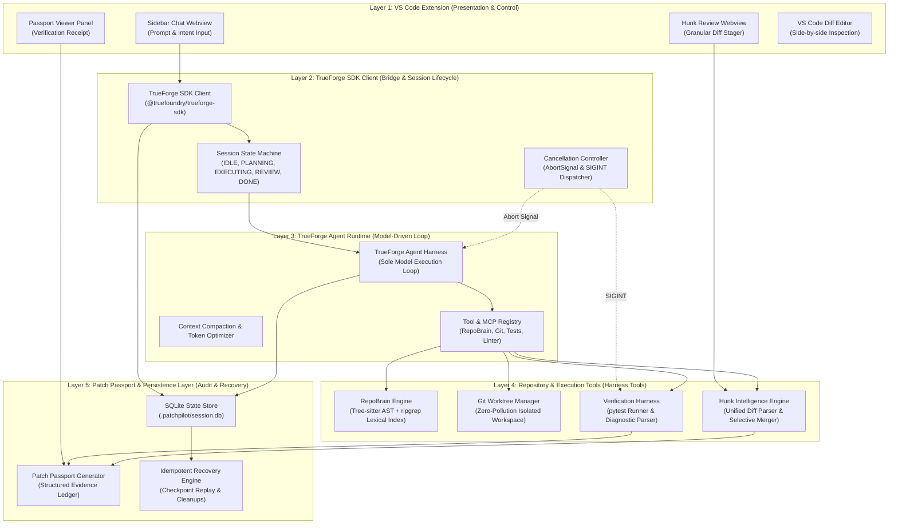
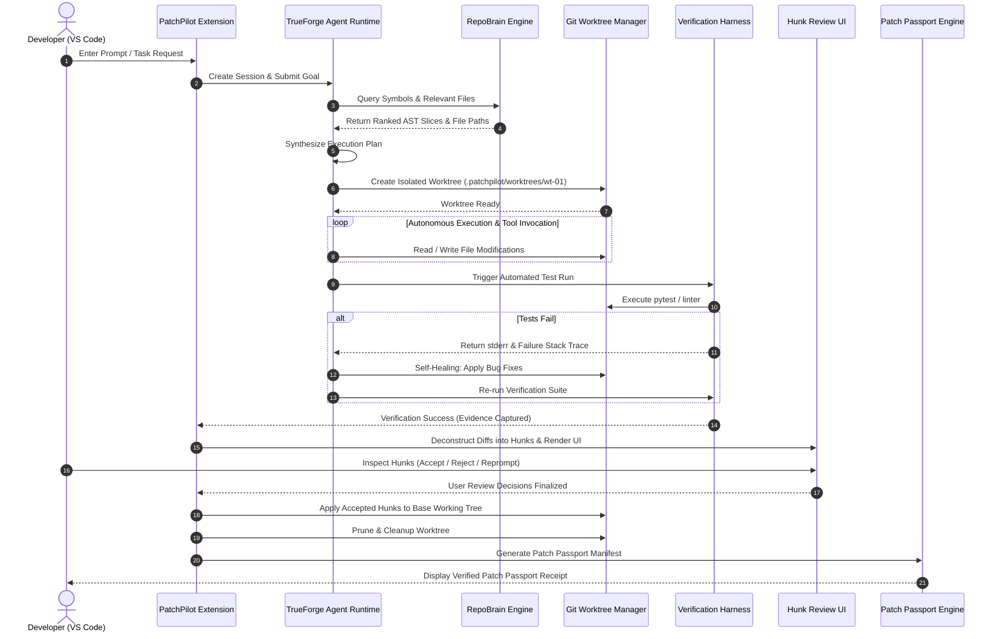

# PATCHPILOT — INITIAL ENGINEERING DOCUMENTATION
**System Architecture, Technical Specification & Product Requirements Document**

- **Project Name:** PatchPilot
- **Repository:** `https://github.com/madhura200227/PatchPilot`
- **Default Branch:** `main`
- **Competition:** TrueFoundry Forge-a-thon — Techfest, IIT Bombay
- **Product Category:** VS Code-Native AI Coding Agent
- **Agent Harness & Runtime:** TrueForge (`@truefoundry/trueforge-sdk`)
- **Primary Demonstration Target:** `pallets/flask`
- **Status:** Initial Specification & Architecture Foundation (Implementation Pending)
- **Document Version:** 1.0.0

---

## 1. EXECUTIVE SUMMARY & VALUE PROPOSITION

### 1.1 Product Tagline
> **"Code changes you can inspect, verify and trust."**

### 1.2 Core Value Proposition
PatchPilot is an editor-native AI coding agent built as a Visual Studio Code extension. Powered strictly by the **TrueForge** agent harness, PatchPilot solves the fundamental trust, control, and reliability crisis in generative software engineering. 

Rather than treating AI code generation as an opaque autocomplete or a reckless agent that directly mutates a developer's working directory, PatchPilot enforces:
1. **Repository Intelligence (RepoBrain):** Context-aware codebase navigation combining Abstract Syntax Tree (AST) symbol graphs with lexical search to fit high-signal context into bounded windows.
2. **Atomic Multi-File Editing in Isolated Worktrees:** Code modifications execute inside isolated Git worktrees, ensuring zero pollution of the developer's working tree or active branch.
3. **Hunk Intelligence:** Fine-grained diff inspection allowing developers to accept, reject, or re-prompt individual semantic code hunks rather than all-or-nothing file updates.
4. **Self-Healing Verification Loop:** Automated test execution and linting inside the isolated workspace, feeding failures back to TrueForge for autonomous self-correction before human review.
5. **Idempotent Crash Recovery & Instant Cancellation:** SQLite-backed state checkpointing and immediate SIGINT/cancellation propagation to prevent corrupted git states and lost reasoning.
6. **Patch Passport (Signature Differentiator):** A tamper-evident, structured audit manifest accompanying every patch that binds the original prompt, execution plan, affected AST symbols, hunk review decisions, test logs, and TrueForge model telemetry into a single verifiable receipt.

---

## 2. PROBLEM STATEMENT & INDUSTRY CONTEXT

### 2.1 The Crisis of Uncontrolled AI Modifications
Existing AI coding assistants (e.g., GitHub Copilot, Cursor, Devin-style autonomous prototypes) suffer from critical architectural and operational failure modes:

| Failure Mode | Industry Reality | PatchPilot Architectural Solution |
| :--- | :--- | :--- |
| **Working Tree Pollution** | Agents modify unstaged/staged files directly in the active developer workspace, overwriting uncommitted work and leaving partial diffs on crash. | **Git Worktree Isolation:** Edits occur in an isolated directory (`.patchpilot/worktrees/wt-<id>`); developer's branch is never touched until explicit approval. |
| **Black-Box Multi-File Drift** | In large codebases (e.g., `pallets/flask`), agents make edits across multiple files with subtle, undeclared cross-module side effects. | **Intent-to-Plan & RepoBrain:** Structured planning with symbol dependency analysis before execution. |
| **All-or-Nothing Code Review** | Standard IDE diff viewers force users to accept or reject an entire file changeset, making minor flaws disqualify good code. | **Hunk Intelligence:** Fine-grained, hunk-by-hunk review with per-hunk accept, reject, or reprompt actions. |
| **Unverified Hallucinations** | Agents declare "Task completed and tests pass" without providing reproducible evidence or running test suites. | **Self-Healing Verification Loop & Patch Passport:** Automatic execution of test suites (`pytest`), diagnostic feedback loops, and an immutable evidence receipt. |
| **Brittle Failures & Lost State** | Network timeouts or model rate limits crash agent sessions, wiping reasoning traces and leaving abandoned files. | **SQLite State Engine:** Checkpoint persistence after every step, allowing deterministic session recovery. |

---

## 3. COMPETITION ALIGNMENT & REQUIREMENTS MATRIX

### 3.1 TrueFoundry Forge-a-thon (Techfest, IIT Bombay)
The TrueFoundry Forge-a-thon challenges engineers to build a production-grade coding agent structured as a VS Code extension that operates strictly on the **TrueForge** harness.

### 3.2 Formal Requirements Compliance

| Competition Mandate | Strict Requirement | PatchPilot Architectural Enforcement |
| :--- | :--- | :--- |
| **Agent Runtime** | Must run strictly on TrueForge. No custom model-driven execution loops. | **TrueForge Sole Loop Rule:** TrueForge owns the model-driven orchestration loop. PatchPilot acts as the IDE harness, tool provider, and evidence auditor. |
| **Form Factor** | VS Code extension (`vscode` API). | Pure TypeScript extension utilizing VS Code Custom Webviews, Diff Editor API, and Command Registry. |
| **Repository Scale** | Must handle large real-world repositories without context exhaustion. | Primary testbench is `pallets/flask`. RepoBrain extracts relevant AST subgraphs and compacts context. |
| **Multi-File Edits** | Autonomous multi-file modifications. | Multi-file patch synthesis coordinated transactionally across worktree files. |
| **Diff Review** | Safe, granular diff review before applying changes. | Dedicated Hunk Intelligence Webview supporting granular hunk-level staging. |
| **Failure Recovery** | Robust handling of model failures and exceptions. | Checkpoint store persists state to SQLite; failed tool calls trigger self-healing or graceful rollback. |
| **Cancellation** | Immediate cancellation of running agent tasks. | AbortController propagation stops TrueForge loops and kills running subprocesses instantly. |
| **Evaluation Repo** | Demonstration on `pallets/flask`. | 3 official demonstration tasks validated against `pallets/flask` test suites. |

---

## 4. SYSTEM ARCHITECTURE & 5-LAYER STACK



### 4.1 Layer Responsibilities & Boundaries

#### Layer 1: VS Code Extension
- **Responsibilities:** Renders user interfaces, captures user prompts, registers IDE commands, hosts custom Webview panels for Chat, Hunk Review, and Patch Passport, and integrates with the native VS Code Diff Editor.
- **Boundaries:** Does not make direct LLM API calls; delegates all agent execution to Layer 2.

#### Layer 2: TrueForge SDK Client
- **Responsibilities:** Manages the client-side lifecycle of agent sessions, maintains the session Finite State Machine (FSM), handles streaming events, and manages cooperative cancellation tokens (`AbortController`).
- **Boundaries:** Interfaces with the TrueForge runtime via `@truefoundry/trueforge-sdk`.

#### Layer 3: TrueForge Agent Runtime
- **Responsibilities:** **The sole owner of the model-driven autonomous loop.** Selects tools, executes context compaction, reasons over problem states, routes requests to LLM providers, and invokes registered tools.
- **Strict Constraint:** PatchPilot shall never implement a parallel or secondary model-driven execution loop.

#### Layer 4: Repository & Execution Tools
- **Responsibilities:** Local execution capabilities exposed to TrueForge as tools (or MCP servers):
  - `RepoBrain`: Codebase indexing, AST parsing, symbol search, and context ranking.
  - `WorktreeManager`: Creation, isolation, diff generation, and pruning of Git worktrees.
  - `HunkEngine`: Deconstruction of unified diffs into semantic hunks; selective hunk application.
  - `VerificationHarness`: Execution of project test suites (`pytest`) and linters with diagnostic capture.
- **Boundaries:** Only operates on files inside the designated isolated worktree.

#### Layer 5: Patch Passport & Persistence Layer
- **Responsibilities:** Persists session history, checkpoints, tool invocations, and review decisions to local SQLite (`.patchpilot/session.db`). Synthesizes and verifies the cryptographic/structured Patch Passport manifest.
- **Boundaries:** Read/write access strictly scoped to the `.patchpilot` metadata directory.

---

## 5. CORE SUBSYSTEM SPECIFICATIONS

### 5.1 RepoBrain — Repository Intelligence
RepoBrain enables TrueForge to navigate codebases containing thousands of files (such as `pallets/flask`) without overflowing context windows or ingesting irrelevant code.

- **AST Analysis:** Uses Tree-sitter parsers to extract code symbols (functions, classes, decorators, imports, call references).
- **Lexical Search:** Employs `ripgrep` for blazing-fast regex and identifier discovery across files.
- **Relevance Graph:** Ranks files and symbols by relevance to the user prompt and tracks import/export dependency edges.
- **Context Compactor:** Packages extracted code slices into token-bounded context blocks formatted for TrueForge's context compaction system.

### 5.2 Intent-to-Plan Engine
Converts natural language user instructions into a structured, executable blueprint before code modification starts:
1. **Goal Decomposition:** Breaks high-level requirements into discrete steps (e.g., update function signature, update caller, update test case).
2. **Impact Boundary:** Identifies primary files to modify and secondary files to inspect.
3. **Verification Criteria:** Specifies what tests or linter checks must pass for the task to be considered complete.

### 5.3 Atomic Multi-File Editing in Git Worktrees
To achieve zero-pollution workspace safety:
1. **Creation:** PatchPilot runs `git worktree add -b patchpilot/session-<id> .patchpilot/worktrees/wt-<id> HEAD`.
2. **Isolation:** TrueForge tools execute file writes exclusively within the worktree directory.
3. **Developer Protection:** The developer's active workspace, uncommitted files, and current branch remain completely untouched during agent reasoning, file editing, and test runs.
4. **Transactionality:** If the session is aborted or rejected, the worktree and temporary branch are pruned cleanly with `git worktree remove --force`.

### 5.4 Hunk Intelligence & Review Methodology
Standard unified diffs represent changes per file. Hunk Intelligence breaks diffs down into semantic hunks:
- **Semantic Chunking:** Each hunk contains a continuous block of changes with line numbers, context lines, and associated AST symbols.
- **Interactive Review UI:** Developers inspect each hunk in VS Code with three options:
  - **Accept:** Staged for inclusion in the final commit.
  - **Reject:** Discarded; original code retained.
  - **Re-Prompt / Refine:** Sends the specific hunk back to TrueForge with feedback for modification.
- **Selective Application:** Uses `git apply --cached` with custom patch construction to commit only the accepted hunks to the target branch.

### 5.5 Self-Healing Verification Loop
Generative coding requires empirical verification:
1. **Execution:** After TrueForge performs edits in the worktree, the Verification Harness automatically executes the test suite (`pytest -v`).
2. **Parsing:** Captures test results, stack traces, failure messages, and linter errors (`flake8`, `mypy`).
3. **Feedback Loop:** If tests fail, the diagnostic output is injected back into the TrueForge agent loop as a verification failure prompt.
4. **Autonomous Correction:** TrueForge inspects the failure stack trace, modifies the worktree files, and re-triggers verification (bounded by max 3 retry iterations).
5. **Human Presentation:** The review UI is only populated once tests pass or retries are exhausted.

### 5.6 Crash Recovery & Cancellation Engine
- **Idempotent Checkpointing:** Every significant state transition (Plan Generated, File Written, Tests Executed, Hunk Decided) is committed to SQLite with a monotonically increasing sequence ID.
- **Replay & Resumption:** If VS Code crashes or the network disconnects, PatchPilot detects the active session in SQLite, verifies the worktree integrity, and resumes the session at the last valid checkpoint.
- **Immediate Cancellation:** When the developer clicks "Cancel", an `AbortSignal` is dispatched to the TrueForge SDK, running subprocesses receive `SIGINT`/`SIGKILL`, the worktree is cleanly dismantled, and the session status is recorded as `CANCELLED`.

---

## 6. THE SIGNATURE DIFFERENTIATOR: PATCH PASSPORT

The **Patch Passport** is PatchPilot's signature product innovation. It is an audit-grade, verifiable manifest generated for every accepted code modification.

### 6.1 Purpose & Motivation
AI-generated code currently lacks provenance and accountability. Reviewers cannot verify how an agent arrived at a diff, whether tests actually ran, or what human review decisions took place. Patch Passport bridges this gap.

### 6.2 Passport Data Schema (Proposed Specification)

```json
{
  "$schema": "https://patchpilot.dev/schemas/v1/passport.json",
  "passport_id": "pp_8f14b2d9_4e81_4c72_b3a1_9a56c710e2d1",
  "version": "1.0.0",
  "timestamp": "2026-11-17T14:30:00.000Z",
  "session": {
    "session_id": "sess_01J8ABCXYZ",
    "agent_harness": "TrueForge v0.8.2",
    "model_id": "meta-llama/llama-3.3-70b-instruct",
    "total_token_usage": 14250,
    "duration_ms": 48200
  },
  "intent": {
    "raw_prompt": "Refactor URL route matching in Flask to handle trailing slash redirection cleanly and update route unit tests.",
    "plan_summary": "1. Inspect flask/sansio/scaffold.py and flask/blueprints.py\n2. Modify route registration\n3. Run pytest tests/test_routing.py"
  },
  "changeset": {
    "base_commit": "39b114d86ac31413aed0c7603540d1f93a59a855",
    "target_branch": "main",
    "affected_files": [
      {
        "path": "src/flask/sansio/scaffold.py",
        "status": "modified",
        "hunks_total": 3,
        "hunks_accepted": 3,
        "hunks_rejected": 0
      },
      {
        "path": "tests/test_routing.py",
        "status": "modified",
        "hunks_total": 2,
        "hunks_accepted": 2,
        "hunks_rejected": 0
      }
    ]
  },
  "hunk_decisions": [
    {
      "file": "src/flask/sansio/scaffold.py",
      "hunk_id": "hunk_001",
      "decision": "ACCEPTED",
      "reviewed_at": "2026-11-17T14:31:12.000Z"
    }
  ],
  "verification_evidence": {
    "framework": "pytest",
    "command": "pytest tests/test_routing.py",
    "exit_code": 0,
    "tests_total": 42,
    "tests_passed": 42,
    "tests_failed": 0,
    "self_healing_iterations": 1,
    "linter_check": "flake8 PASSED"
  },
  "recovery_history": {
    "interrupted": false,
    "checkpoints_recovered": 0
  },
  "integrity_digest": "sha256:d489b024e8c1...e58b1a"
}
```

---

## 7. WORKFLOW ARCHITECTURE & COMPLETE LIFECYCLE



---

## 8. PROPOSED TECHNOLOGY STACK

All technologies listed below represent the **proposed** technical architecture and are subject to empirical verification during development:

| Component | Technology | Proposed Version / Spec | Purpose |
| :--- | :--- | :--- | :--- |
| **Primary Language** | TypeScript | `^5.4.0` | Strict type safety for extension and toolchain. |
| **Extension Host** | VS Code Extension API | `^1.90.0` | Editor UI, Custom Webview Panels, Commands. |
| **Agent Harness** | TrueForge Runtime | Latest Open Source | Sole autonomous agent loop runtime. |
| **Harness Client** | `@truefoundry/trueforge-sdk` | Proposed NPM package | Client bridge for TrueForge communication. |
| **Tool Protocol** | Model Context Protocol (MCP) | Latest Spec | Standardized tool exposition to TrueForge. |
| **VCS & Isolation** | Git & Git Worktrees | Git CLI `2.30+` | Version control and isolated branch staging. |
| **Lexical Search** | `ripgrep` (`rg`) | `^14.1.0` | High-speed identifier and pattern discovery. |
| **AST Parser** | Tree-sitter / `web-tree-sitter`| `^0.22.0` | AST generation for Python (`pallets/flask`). |
| **State Persistence** | SQLite | `better-sqlite3` `^9.0.0` | Local checkpoint and session state persistence. |
| **Test Framework** | Vitest | `^1.6.0` | Fast unit and integration testing of TypeScript code. |
| **Extension Packaging**| `@vscode/vsce` | `^2.24.0` | Packaging and publishing VS Code VSIX extension. |

---

## 9. PROPOSED REPOSITORY DIRECTORY STRUCTURE

```text
PatchPilot/
├── .github/
│   └── workflows/
│       ├── ci.yml                 # Proposed CI: lint, typecheck, vitest
│       └── release.yml            # Proposed VSCE packaging workflow
├── docs/
│   ├── ARCHITECTURE.md            # Deep-dive system architecture specification
│   ├── WORKFLOWS.md               # End-to-end lifecycle, recovery & cancellation
│   └── COMPETITION_COMPLIANCE.md  # Forge-a-thon requirement matrix & demo guide
├── src/
│   ├── extension.ts               # VS Code extension entry point & activation
│   ├── client/                    # TrueForge SDK Client & session management
│   │   ├── trueforgeClient.ts
│   │   └── sessionManager.ts
│   ├── repobrain/                 # Repository Intelligence engine
│   │   ├── astParser.ts           # Tree-sitter symbol graph analyzer
│   │   ├── searchIndex.ts         # ripgrep integration
│   │   └── contextRanker.ts       # Context relevance ranking
│   ├── workspace/                 # Git worktree & isolation harness
│   │   ├── worktreeManager.ts     # Worktree creation, pruning, cleanup
│   │   └── gitHarness.ts          # Git command wrapper & path validator
│   ├── hunk/                      # Hunk review & diff decomposition
│   │   ├── diffParser.ts          # Unified diff to semantic hunks
│   │   └── hunkMerger.ts          # Selective patch application
│   ├── verification/              # Test execution & self-healing harness
│   │   ├── testRunner.ts          # pytest/unittest execution
│   │   └── linterHarness.ts       # Flake8/mypy diagnostic capture
│   ├── passport/                  # Patch Passport evidence engine
│   │   ├── passportGenerator.ts   # Manifest generation
│   │   └── auditLogger.ts         # Provenance & evidence recorder
│   ├── storage/                   # Persistence & crash recovery
│   │   ├── database.ts            # SQLite database manager
│   │   └── checkpointStore.ts     # State persistence & idempotent replay
│   └── ui/                        # Webview views & providers
│       ├── chatViewProvider.ts    # Sidebar chat & agent interface
│       ├── hunkReviewPanel.ts     # Hunk-by-hunk diff review webview
│       └── passportViewer.ts      # Patch Passport viewer panel
├── test/
│   ├── unit/                      # Vitest unit test suite
│   ├── integration/               # Worktree & TrueForge SDK mock tests
│   └── fixtures/flask/            # Pallets/flask test scenarios
├── PATCHPILOT_INITIAL_ENGINEERING_DOCUMENTATION.md  # Foundational specification
├── package.json                   # Proposed extension manifest & dependencies
├── tsconfig.json                  # TypeScript compiler configuration
├── vitest.config.ts               # Test runner configuration
└── README.md                      # Primary project overview & documentation portal
```

---

## 10. SECURITY, PERMISSIONS & ISOLATION

1. **Workspace Boundary Enforcement:** File modifications are restricted to the designated Git worktree. Absolute path validation prevents directory traversal (`../`).
2. **Secret & Credential Exclusion:** RepoBrain automatically excludes `.env`, `*.pem`, `id_rsa`, `.git/credentials`, and sensitive dotfiles from model context.
3. **Execution Whitelist:** Test runners and linters are invoked via whitelisted binary paths (`pytest`, `python -m unittest`, `flake8`) with parameterized arguments. Arbitrary shell commands require explicit user consent.
4. **Prompt Injection Defense:** Repository contents are presented to the agent as data blocks distinct from operational system prompts.
5. **Human Approval Safeguards:** Destructive operations (overwriting files, committing changes, deleting worktrees) require explicit developer interaction.

---

## 11. TESTING STRATEGY & ACCEPTANCE CRITERIA

### 11.1 Testing Methodology
- **Unit Testing (Vitest):** Tests individual components: diff parser, hunk chunker, AST symbol extractor, and SQLite checkpoint store.
- **Integration Testing:** Tests Git worktree creation, isolated file modification, selective patch application, and cancellation signal propagation.
- **TrueForge Mock Suite:** Tests TrueForge SDK client behavior using mock server endpoints simulating normal completions, streaming tokens, test failures, and network timeouts.
- **Benchmark Suite (`pallets/flask`):** Automated validation against official Flask tasks, ensuring all existing and new tests pass cleanly.

### 11.2 MVP Acceptance Criteria
1. VS Code extension successfully installs and activates.
2. User prompt initiates a session via `@truefoundry/trueforge-sdk`.
3. Agent reads and modifies files strictly in an isolated Git worktree.
4. Diffs are decomposed and rendered in a Hunk Review Webview.
5. Developer can accept or reject individual hunks.
6. Verification loop runs `pytest` and captures evidence.
7. Valid Patch Passport JSON is emitted upon completion.
8. Immediate cancellation prunes worktrees without corrupting base branch.

---

## 12. DEVELOPMENT MILESTONES & PRIORITIZATION

- **Milestone 0 (P0 — Foundation & Harness Setup):**
  - Repository documentation & engineering foundation (Current Stage).
  - Extension skeleton & TrueForge SDK client integration.
  - Git worktree manager & isolation harness.
- **Milestone 1 (P0 — Core Agent Loop & Flask Demonstration):**
  - RepoBrain basic lexical & AST retrieval.
  - Multi-file editing in isolated worktree.
  - Hunk Review Webview.
  - Self-healing verification loop with `pytest`.
  - Patch Passport v1 generation.
  - Demonstration validation on 3 official `pallets/flask` tasks.
- **Milestone 2 (P1 — Resilience & Advanced Review):**
  - SQLite idempotent crash recovery.
  - Interactive hunk refinement / re-prompting.
  - Cryptographic integrity digest for Patch Passport.
- **Milestone 3 (P2 — Ecosystem & Extensions):**
  - Visual timeline viewer for Patch Passport history.
  - Cross-IDE compatibility research.
  - TrueForge harness upstream contributions.

---

## 13. FOUR-MINUTE DEMONSTRATION STRUCTURE (COMPETITION SPECIFICATION)

The competition video submission requires a strict 4-minute demonstration on `pallets/flask`:

- **0:00 – 0:45 | Architectural Intro & Workspace Cleanliness:**
  - Introduce PatchPilot and its TrueForge-powered architecture.
  - Show `pallets/flask` in VS Code with existing uncommitted developer edits.
- **0:45 – 1:45 | Task 1 Execution & Isolated Worktree:**
  - Dispatch Task 1 to TrueForge agent.
  - Demonstrate isolated worktree generation and parallel reasoning without touching main working tree.
- **1:45 – 2:45 | Verification Loop & Hunk Intelligence:**
  - Show automated test execution catching an initial failure and agent self-healing.
  - Open Hunk Intelligence UI: demonstrate selective acceptance (accept hunk 1, reject hunk 2).
- **2:45 – 3:30 | Tasks 2 & 3 & Immediate Cancellation:**
  - Run Task 2 (multi-file modification with test coverage).
  - Trigger Task 3 and demonstrate instant cancellation, showing immediate cleanup and zero residue.
- **3:30 – 4:00 | Patch Passport Audit & Conclusion:**
  - Inspect the generated Patch Passport manifest.
  - Review test logs, decision history, and token telemetry.

---

## 14. KNOWN TECHNICAL RISKS & ARCHITECTURAL DECISIONS

| Risk Area | Severity | Mitigation Strategy |
| :--- | :--- | :--- |
| **Git Worktree Lock Contention** | Medium | Implement retry backoff and deterministic PID-based lock directory naming. |
| **Context Overflows on Huge Diffs** | High | Apply Tree-sitter symbol pruning and TrueForge context compaction before feeding code back. |
| **Orphaned Worktrees on Sudden Kill** | Low | On extension startup, run orphan garbage collection checking for stale `.patchpilot/worktrees/`. |
| **Selective Hunk Patch Merge Conflicts**| Medium | Use 3-way merge logic (`git apply -3`) and fall back to manual conflict resolution UI. |

---

*This document serves as the formal baseline and architectural specification for PatchPilot.*
