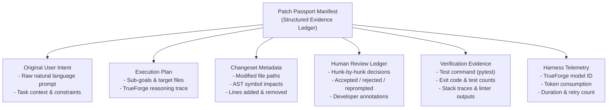
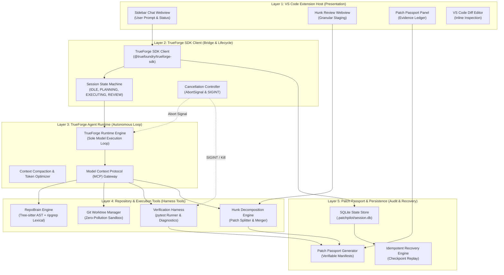
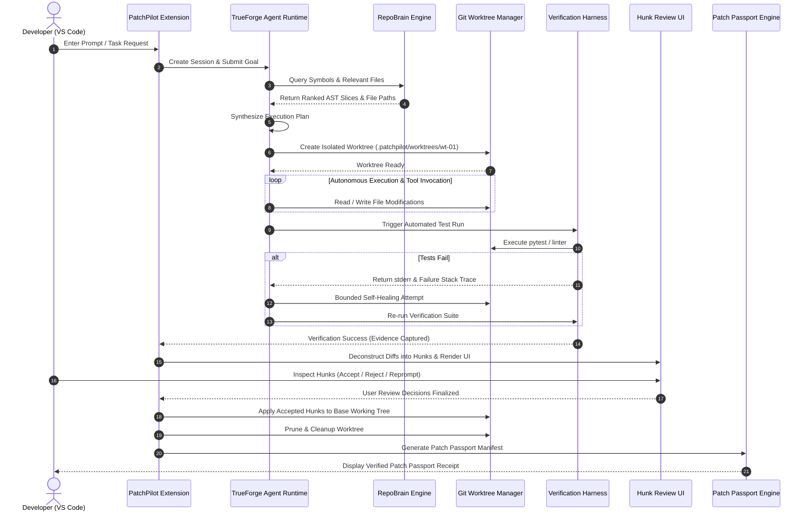
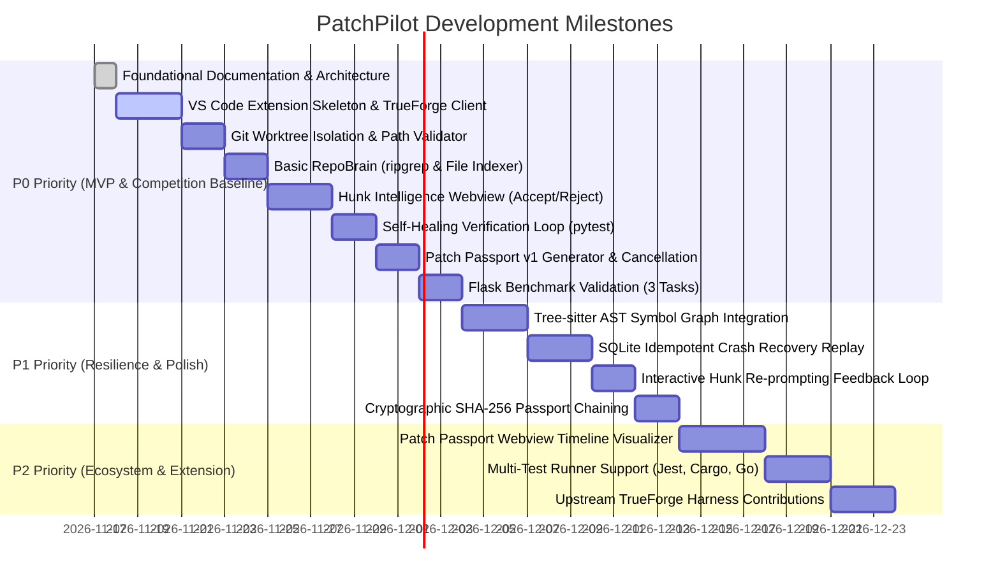

# PatchPilot

> **Code changes you can inspect, verify and trust.**

[](https://techfest.org)
[](https://techfest.org)
[](https://github.com/truefoundry/trueforge)
[](https://github.com/pallets/flask)
[](#18-project-status)

**PatchPilot** is a Visual Studio Code-native AI coding agent designed for transparent, controlled, and verifiable software engineering. Powered strictly by the **TrueForge** agent runtime, PatchPilot executes multi-file modifications inside isolated Git worktrees, validates changes through an automated self-healing test loop, gives developers granular hunk-by-hunk review control, and issues a structured **Patch Passport** manifest verifying the provenance, test logs, and human decisions behind every change (with cryptographic hash chaining planned in P1).

Built for the **TrueFoundry Forge-a-thon** at **Techfest, IIT Bombay**, PatchPilot addresses the core reliability and trust gap in generative coding using `pallets/flask` as its primary testbed.

---

## Table of Contents

- [1. Introduction](#1-introduction)
- [2. Problem Statement](#2-problem-statement)
- [3. Product Vision](#3-product-vision)
- [4. Core Features](#4-core-features)
- [5. The Signature Differentiator: Patch Passport](#5-the-signature-differentiator-patch-passport)
- [6. System Architecture](#6-system-architecture)
- [7. Workflow Architecture](#7-workflow-architecture)
- [8. Technology Stack](#8-technology-stack)
- [9. Repository Structure](#9-repository-structure)
- [10. Security and Reliability](#10-security-and-reliability)
- [11. Competition Alignment](#11-competition-alignment)
- [12. Development Roadmap](#12-development-roadmap)
- [13. Getting Started](#13-getting-started)
- [14. Competition Demonstration](#14-competition-demonstration)
- [15. Testing and Quality Assurance](#15-testing-and-quality-assurance)
- [16. Documentation Hierarchy & Authority](#16-documentation-hierarchy--authority)
- [17. Project Status](#17-project-status)
- [18. Team and Contributions](#18-team-and-contributions)
- [19. License](#19-license)

---

## 1. Introduction

Generative AI coding tools have rapidly transitioned from line-level autocomplete to autonomous multi-file agents. However, conventional coding assistants often act as opaque black boxes: they directly overwrite active developer workspaces, alter files without explaining dependencies, demand all-or-nothing approvals, and declare success without producing empirical test evidence.

**PatchPilot** re-engineers the interaction model between developers and coding agents. Designed natively for Visual Studio Code, PatchPilot bridges high-autonomy agent execution with rigorous software quality guarantees:

- **Repository Intelligence (RepoBrain):** High-signal context extraction combining lexical search with AST symbol extraction and localized reference lookup.
- **Autonomous Multi-File Engineering:** Multi-step planning and cross-module edits orchestrated strictly by the **TrueForge** runtime.
- **Human-Controlled Hunk Review:** Granular diff deconstruction allowing developers to accept, reject, or re-prompt individual code hunks.
- **Verification Evidence:** Automated test execution (`pytest`) and linting within an isolated sandbox before changes are surfaced to the user.
- **Reliable Failure Recovery:** SQLite-backed state checkpointing and instant SIGINT cancellation to prevent corrupt repository states.
- **TrueForge-Powered Agent Execution:** Uncompromising adherence to the TrueForge harness layer for model-driven reasoning and token compaction.

---

## 2. Problem Statement

Contemporary AI coding assistants suffer from structural flaws that prevent adoption in production engineering workflows:

1. **Uncontrolled Workspace Mutations:** Most agents modify unstaged or staged files directly on the developer's active branch. A single faulty tool call or mid-execution crash pollutes uncommitted work and leaves orphan changes.
2. **Black-Box Multi-File Drift:** In complex repositories (such as `pallets/flask`), agents make subtle cross-file changes without explaining the underlying rationale or tracking cross-module impacts.
3. **All-or-Nothing Code Review:** Standard IDE diff interfaces force developers to accept or reject an entire file changeset, discarding 95% of great code due to a single bad line.
4. **Unverified Hallucinations:** Agents frequently assert that code is working and tests pass without actually executing test runners or providing diagnostic logs.
5. **Fragile State & Lost Reasoning:** Network drops, API timeouts, or rate limits terminate agent sessions abruptly, discarding reasoning chains and intermediate diffs.

---

## 3. Product Vision

PatchPilot's mission is to make AI-generated code changes **transparent, controlled, and recoverable**.

```
+-----------------------------------------------------------------------------------+
|                               PATCHPILOT CORE TENETS                              |
|                                                                                   |
|   ISOLATE FIRST           VERIFY EMPIRICALLY       INSPECT GRANULARLY             |
|   Zero edits to user's    Automated test suites    Hunk-by-hunk review            |
|   active branch until     run in sandboxes         with full human veto           |
|   explicitly approved.    before presentation.     over every line.               |
|                                                                                   |
|                 AUDIT CONTINUOUSLY         RESUME DETERMINISTICALLY               |
|                 Structured Patch           Monotonic checkpoints                  |
|                 Passport manifest for      support crash recovery                 |
|                 every accepted change.     and instant cancellation.              |
+-----------------------------------------------------------------------------------+
```

By pairing TrueForge's autonomous agent loop with Git worktree isolation, fine-grained hunk intelligence, and structured proof of verification, PatchPilot transforms AI code generation from an unpredictable gamble into an enterprise-ready engineering process.

---

## 4. Core Features

PatchPilot documents six core capabilities alongside its signature differentiator, the Patch Passport:

### 4.1 RepoBrain — Repository Intelligence
- **Purpose:** Ingests and navigates large-scale codebases (e.g., `pallets/flask`) without exhausting token context windows or introducing noisy distractions.
- **How It Works:** Pairs lexical search (`ripgrep`, P0) with Tree-sitter AST symbol extraction (classes, functions, decorators, imports, P1). Bounded context slices feed into TrueForge (full semantic call graph analysis is an aspirational P1 goal).
- **Why It Matters:** Prevents hallucinated imports and enables accurate context gathering in large repositories.
- **Implementation Status:** Architecture proposed and documented; implementation pending.

### 4.2 Intent-to-Plan Engine
- **Purpose:** Decomposes complex developer prompts into structured, multi-step execution roadmaps before touching any code.
- **How It Works:** TrueForge analyzes the prompt against RepoBrain's symbol graph, producing a declarative JSON plan specifying target files, expected side effects, and verification criteria.
- **Why It Matters:** Provides complete visibility into the agent's strategy before file mutations begin.
- **Implementation Status:** Architecture proposed and documented; implementation pending.

### 4.3 Atomic Multi-File Editing in Git Worktrees
- **Purpose:** Executes cross-file changes in absolute isolation, protecting developer working trees from corruption.
- **How It Works:** Provisions an isolated Git worktree at `.patchpilot/worktrees/wt-<session-id>`. All TrueForge file read/write operations execute strictly inside this sandbox.
- **Why It Matters:** Designed to isolate edits from uncommitted developer work and enable clean teardown upon cancellation (subject to worktree cleanup verification).
- **Implementation Status:** Architecture proposed and documented; implementation pending.

### 4.4 Hunk Intelligence
- **Purpose:** Replaces all-or-nothing file acceptance with granular, hunk-level human control.
- **How It Works:** Parses unified diffs (`git diff HEAD`) into discrete semantic hunks. A custom VS Code Webview displays each hunk with context-aware actions: `[Accept]`, `[Reject]`, or `[Re-prompt]`.
- **Why It Matters:** Developers can selectively accept valid changes while rejecting or refining flawed hunks.
- **Implementation Status:** Architecture proposed and documented; implementation pending.

### 4.5 Self-Healing Verification Loop
- **Purpose:** Automatically validates generated code against empirical test suites and linters.
- **How It Works:** Automatically executes `pytest` and linters inside the isolated worktree. If tests fail, stack traces and error messages are fed back to TrueForge to attempt a bounded self-healing cycle (up to 3 iterations; non-guaranteed heuristic repair).
- **Why It Matters:** Catches regressions before human review, saving developers from debugging syntax errors or broken tests.
- **Implementation Status:** Architecture proposed and documented; implementation pending.

### 4.6 Crash Recovery Engine
- **Purpose:** Ensures agent sessions survive network drops, model timeouts, and IDE restarts.
- **How It Works:** Employs an embedded SQLite database (`.patchpilot/session.db`) to record monotonic checkpoints. On startup, PatchPilot inspects SQLite for interrupted sessions, validates worktree integrity, and offers an idempotent resume path where state is consistent.
- **Why It Matters:** Eliminates lost reasoning and duplicate token costs caused by unexpected failures.
- **Implementation Status:** Architecture proposed and documented; implementation pending.

---

## 5. The Signature Differentiator: Patch Passport

The **Patch Passport** is PatchPilot's signature product innovation. It serves as an audit-grade, verifiable manifest generated for every accepted code modification.

### What the Patch Passport Binds Together



### Purpose & Value
- **Enterprise Auditability:** Engineering teams can inspect exactly which prompt, model, and review decisions created a diff.
- **CI/CD Integration:** Upstream CI/CD pipelines can inspect the Patch Passport to confirm tests passed inside the agent sandbox before merging.
- **Zero Fabrication:** The manifest records factual execution logs, exit codes, and timestamps—never synthetic or assumed outcomes.
- **Implementation Status:** Specification and schema documented; generator implementation pending.

---

## 6. System Architecture

PatchPilot is organized into five principal architecture layers with strict component boundaries:



### Strict Architectural Rule: TrueForge Sole Loop Authority
> **TrueForge owns the model-driven agent execution loop.** PatchPilot strictly interfaces with TrueForge via `@truefoundry/trueforge-sdk`. PatchPilot does **not** implement a separate or fallback model-driven orchestration loop. PatchPilot acts as the IDE presentation layer, tool provider, verification harness, and evidence recorder.

For complete architectural details, see [docs/ARCHITECTURE.md](file:///e:/MADHURA/PROJECTS%20madhura/PatchPilot/docs/ARCHITECTURE.md).

---

## 7. Workflow Architecture

The complete PatchPilot workflow moves through eleven well-defined operational phases:

```
[User Request] 
      │
      ▼
[Repository Analysis (RepoBrain)] 
      │
      ▼
[Context Retrieval (AST + ripgrep)] 
      │
      ▼
[Task Planning (TrueForge Engine)] 
      │
      ▼
[Isolated Workspace (Git Worktree)] 
      │
      ▼
[TrueForge Autonomous Execution] 
      │
      ▼
[Multi-File Changes Applied] 
      │
      ▼
[Self-Healing Verification Loop (pytest)] ◀─── Failures fed back to TrueForge (max 3)
      │ (Tests Pass)
      ▼
[Diff Generation (git diff HEAD)] 
      │
      ▼
[Hunk Intelligence Review (Accept / Reject / Reprompt)] 
      │
      ▼
[Patch Application & Worktree Cleanup] 
      │
      ▼
[Patch Passport Issuance]
```



### Failure Recovery & Cancellation Paths
- **Immediate Cancellation:** Developer clicking "Cancel" dispatches `AbortSignal` to TrueForge SDK, sends `SIGINT`/`SIGTERM` to running child processes (e.g. `pytest`), prunes the temporary worktree, and transitions session state to `CANCELLED` without polluting the active developer branch.
- **Crash Recovery:** If IDE restarts, PatchPilot queries SQLite, validates the state of any existing worktrees, and prompts the developer to resume from the last valid checkpoint if the workspace state is consistent.

For detailed sequence diagrams and state machines, see [docs/WORKFLOWS.md](file:///e:/MADHURA/PROJECTS%20madhura/PatchPilot/docs/WORKFLOWS.md).

---

## 8. Technology Stack

The following table documents the proposed technical foundation for PatchPilot:

| Component | Technology | Proposed Version / Spec | Justification & Purpose | Status |
| :--- | :--- | :--- | :--- | :--- |
| **Language** | TypeScript | `^5.4.0` | Strict static typing across extension and toolchain. | Proposed |
| **Extension API** | VS Code Extension API | `^1.90.0` | Native editor integration, Custom Webviews, Diff Editor. | Proposed |
| **Agent Runtime** | TrueForge Runtime | Latest Open Source | Sole autonomous agent loop runtime (competition mandate). | Proposed |
| **Harness Client** | `@truefoundry/trueforge-sdk` | Proposed NPM package | Official client bridge for TrueForge communication. | Proposed |
| **Tool Protocol** | Model Context Protocol (MCP) | Latest Spec | Standardized tool exposition to TrueForge. | Proposed |
| **VCS & Isolation** | Git & Git Worktrees | Git CLI `2.30+` | Zero-pollution isolated workspace staging. | Proposed |
| **Lexical Search** | `ripgrep` (`rg`) | `^14.1.0` | Ultra-fast regex and symbol discovery across codebases. | Proposed |
| **AST Parser** | Tree-sitter / `web-tree-sitter` | `^0.22.0` | AST symbol graph analysis for Python (`pallets/flask`). | Proposed |
| **Persistence** | SQLite | `better-sqlite3` `^9.0.0` | Monotonic checkpointing and session persistence. | Proposed |
| **Test Runner** | Vitest | `^1.6.0` | Unit and integration testing of extension components. | Proposed |
| **Packaging** | `@vscode/vsce` | `^2.24.0` | Extension packaging and VSIX bundle generation. | Proposed |

*Note: All technologies listed above represent the proposed technical architecture and will be verified during implementation.*

---

## 9. Repository Structure

The proposed project layout reflects strict separation of concerns across presentation, client, tools, verification, and persistence:

```text
PatchPilot/
├── .github/
│   └── workflows/
│       ├── ci.yml                 # Proposed CI: lint, typecheck, vitest
│       └── release.yml            # Proposed VSCE packaging workflow
├── docs/
│   ├── ARCHITECTURE.md            # Deep-dive system architecture specification
│   ├── WORKFLOWS.md               # End-to-end lifecycle, recovery & cancellation
│   └── COMPETITION_COMPLIANCE.md  # Forge-a-thon requirement matrix & demo guide
├── src/
│   ├── extension.ts               # VS Code extension entry point & activation
│   ├── client/                    # TrueForge SDK Client & session management
│   │   ├── trueforgeClient.ts
│   │   └── sessionManager.ts
│   ├── repobrain/                 # Repository Intelligence engine
│   │   ├── astParser.ts           # Tree-sitter symbol graph analyzer
│   │   ├── searchIndex.ts         # ripgrep integration
│   │   └── contextRanker.ts       # Context relevance ranking
│   ├── workspace/                 # Git worktree & isolation harness
│   │   ├── worktreeManager.ts     # Worktree creation, pruning, cleanup
│   │   └── gitHarness.ts          # Git command wrapper & path validator
│   ├── hunk/                      # Hunk review & diff decomposition
│   │   ├── diffParser.ts          # Unified diff to semantic hunks
│   │   └── hunkMerger.ts          # Selective patch application
│   ├── verification/              # Test execution & self-healing harness
│   │   ├── testRunner.ts          # pytest/unittest execution
│   │   └── linterHarness.ts       # Flake8/mypy diagnostic capture
│   ├── passport/                  # Patch Passport evidence engine
│   │   ├── passportGenerator.ts   # Manifest generation
│   │   └── auditLogger.ts         # Provenance & evidence recorder
│   ├── storage/                   # Persistence & crash recovery
│   │   ├── database.ts            # SQLite database manager
│   │   └── checkpointStore.ts     # State persistence & idempotent replay
│   └── ui/                        # Webview views & providers
│       ├── chatViewProvider.ts    # Sidebar chat & agent interface
│       ├── hunkReviewPanel.ts     # Hunk-by-hunk diff review webview
│       └── passportViewer.ts      # Patch Passport viewer panel
├── test/
│   ├── unit/                      # Vitest unit test suite
│   ├── integration/               # Worktree & TrueForge SDK mock tests
│   └── fixtures/flask/            # Pallets/flask test scenarios
├── PATCHPILOT_INITIAL_ENGINEERING_DOCUMENTATION.md  # Foundational specification
├── package.json                   # Proposed extension manifest & dependencies
├── tsconfig.json                  # TypeScript compiler configuration
├── vitest.config.ts               # Test runner configuration
└── README.md                      # Primary project overview & documentation portal
```

*Note: Directory structure represents the planned implementation layout. Source code directories will be populated as development progresses.*

---

## 10. Security and Reliability

PatchPilot adheres to strict security, isolation, and reliability controls:

1. **Workspace Boundary Enforcement:** File modifications are restricted to the active isolated Git worktree. Canonical path resolution prevents directory traversal attacks (`../`).
2. **Secret & Key Exclusion:** RepoBrain automatically filters out `.env`, `*.pem`, `id_rsa`, `.git/credentials`, and sensitive dotfiles from model context windows.
3. **Command Execution Whitelist:** Automated verification invokes strictly whitelisted binaries (`pytest`, `python -m unittest`, `flake8`, `mypy`) using parameterized arguments. Arbitrary shell commands require explicit developer confirmation.
4. **Human Approval Safeguards:** No code changes are applied to the user's active branch without explicit developer confirmation in the Hunk Review Webview.
5. **Prompt Injection Protection:** Repository code is presented to the model as demarcated data blocks, separate from operational system instructions.
6. **Immediate Cooperative Cancellation:** User cancellation propagates an `AbortSignal` to TrueForge and issues `SIGINT`/`SIGTERM` to running child processes.
7. **Idempotent Checkpointing:** State is recorded monotonically in SQLite; replaying from a checkpoint cannot duplicate worktree edits or corrupt git index state.
8. **Protection of Original Developer Changes:** Uncommitted developer changes on the active branch are never touched, stashed, or overwritten.

---

## 11. Competition Alignment

PatchPilot is engineered specifically to address the evaluation criteria of the **TrueFoundry Forge-a-thon** at **Techfest, IIT Bombay**:

| Forge-a-thon Mandate | Competition Expectation | PatchPilot Engineering Solution |
| :--- | :--- | :--- |
| **TrueForge Loop** | Agent loop must run strictly on TrueForge. | **Sole Loop Rule:** TrueForge owns all model-driven reasoning and tool dispatch; PatchPilot provides the editor harness. |
| **Large Codebase Understanding** | Efficient navigation of large repos without token blowup. | RepoBrain pairs Tree-sitter AST symbol graphs with `ripgrep` lexical index to feed compact context slices to TrueForge. |
| **Autonomous Multi-File Editing** | Coordinated edits across multiple files. | Isolated Git worktrees enable atomic, transactional multi-file modifications. |
| **Hunk-by-Hunk Review** | Safe diff inspection before applying changes. | Custom Webview allows developers to inspect, accept, reject, or re-prompt individual hunks. |
| **Model Failure Recovery** | Robust handling of timeouts and failures. | SQLite checkpoint store enables idempotent resumption for resumable sessions; bounded self-healing loop (up to 3 retries) attempts automated test repair. |
| **Immediate Cancellation** | Instant halt of running agent tasks. | AbortController propagation signals TrueForge runtime to halt, terminates active subprocesses via SIGINT/SIGTERM, and prunes temporary worktree. |
| **Demonstration Repository** | Evaluated on `pallets/flask`. | Official task demonstration targets Tasks A, B, and C on pallets/flask (exact prompts awaiting official competition release; generic rehearsal fixtures utilized for preliminary validation). |

For the complete compliance matrix and judging alignment, see [docs/COMPETITION_COMPLIANCE.md](file:///e:/MADHURA/PROJECTS%20madhura/PatchPilot/docs/COMPETITION_COMPLIANCE.md).

---

## 12. Development Roadmap

Development is organized across three priority tiers (P0, P1, P2):



### Milestone Details
- **P0 (Must-Have for MVP & Forge-a-thon Submission):** TrueForge SDK integration, isolated Git worktree manager, basic RepoBrain lexical retrieval, Hunk Review Webview, self-healing loop with `pytest`, Patch Passport v1 generation, cancellation handling, and validation on three `pallets/flask` scenarios.
- **P1 (Core Enhancements):** Tree-sitter AST symbol graphs, SQLite crash recovery resumption, interactive hunk re-prompting, and cryptographic passport chaining.
- **P2 (Advanced Capabilities):** Visual timeline viewer, multi-language test harnesses, and upstream contributions to TrueForge.

---

## 13. Getting Started

> **Notice: Development setup — implementation pending.**  
> The instructions below document the planned environment configuration and build procedure for development. Application runtime code is currently pending implementation.

### Prerequisites (Proposed)
- Node.js `v20.x` or later (LTS recommended)
- npm `v10.x` or pnpm `v9.x`
- Visual Studio Code `v1.90.0` or higher
- Git `v2.30.0` or higher
- Python `3.10+` with `pytest` (for `pallets/flask` testbed verification)
- TrueForge CLI / Daemon (`npx @truefoundry/trueforge@latest`)

### Proposed Repository Setup Commands
```bash
# 1. Clone the repository
git clone https://github.com/madhura200227/PatchPilot.git
cd PatchPilot

# 2. Install extension and build dependencies (Pending package.json)
npm install

# 3. Compile TypeScript sources (Pending implementation)
npm run build

# 4. Run unit and integration tests (Pending implementation)
npm test

# 5. Launch VS Code Extension Development Host
# Press F5 in VS Code or run:
code --extensionDevelopmentPath=.
```

---

## 14. Competition Demonstration

The Forge-a-thon Round 1 video submission requires a strict 4-minute technical walkthrough on `pallets/flask`:

| Timestamp | Segment Title | Demonstrated Actions & Capabilities |
| :--- | :--- | :--- |
| **0:00 – 0:45** | **Architecture & Workspace Cleanliness** | Introduce PatchPilot and its TrueForge-powered architecture. Show `pallets/flask` in VS Code with existing uncommitted developer files to demonstrate workspace cleanliness. |
| **0:45 – 1:45** | **Rehearsal Task A: Worktree Isolation** | Dispatch rehearsal refactoring goal (provisional task target) to TrueForge. RepoBrain retrieves AST symbols and TrueForge formulates plan. Show Git worktree creation; prove developer branch is untouched. |
| **1:45 – 2:45** | **Verification Loop & Hunk Intelligence** | Automated test runner catches synthetic test regression; TrueForge attempts bounded self-healing. Open Hunk Review UI: selectively accept Hunk 1 and reject Hunk 2. |
| **2:45 – 3:30** | **Rehearsal Task B & C: Cancellation & Bug Fix** | Execute rehearsal bug fix. Trigger next task and click Cancel; demonstrate cooperative cancellation, SIGINT teardown of child processes, worktree pruning, and workspace protection. |
| **3:30 – 4:00** | **Patch Passport Audit & Conclusion** | Open generated Patch Passport. Review verifiable audit trail: user intent, diffs, test logs, review decisions, and TrueForge token telemetry. |

*Note: The official prompts and evaluation rubrics for Tasks A, B, and C have not been released by competition organizers. The demonstration scenario descriptions above represent internal rehearsal targets designed against pallets/flask and will be updated immediately upon release of official task specifications (OD-01, OD-02, OD-03).*

---

## 15. Testing and Quality Assurance

PatchPilot will employ a multi-layered testing strategy:

1. **Unit Testing (Vitest):** Tests standalone algorithmic components including diff parsers, hunk chunking logic, AST symbol extractors, and SQLite checkpoint stores.
2. **Integration Testing:** Tests Git worktree creation, isolated file modification, selective patch staging, and cancellation signal propagation.
3. **TrueForge Harness Mocking:** Tests TrueForge SDK client behavior using mock server endpoints simulating normal completions, streaming tokens, test failures, and network timeouts.
4. **Flask Benchmark Suite (`pallets/flask`):** Rigorous validation against real `pallets/flask` test suites, verifying that generated patches pass existing and newly added regression tests.

---

## 16. Documentation Hierarchy & Authority

PatchPilot documentation is organized in a strict hierarchy of authority. In the event of discrepancy or conflict, specifications higher in the hierarchy supersede lower documents:

1. **[docs/PRD.md](file:///e:/MADHURA/PROJECTS%20madhura/PatchPilot/docs/PRD.md):** Primary product requirements, scope boundaries, core user journeys, and acceptance criteria (PRD v0.1.0).
2. **[docs/ARCHITECTURE.md](file:///e:/MADHURA/PROJECTS%20madhura/PatchPilot/docs/ARCHITECTURE.md):** Technical architecture specification, 5-layer system design, component contracts, and SQLite schema.
3. **[docs/WORKFLOWS.md](file:///e:/MADHURA/PROJECTS%20madhura/PatchPilot/docs/WORKFLOWS.md):** Execution, verification, hunk review, cancellation, and crash recovery workflows.
4. **[docs/COMPETITION_COMPLIANCE.md](file:///e:/MADHURA/PROJECTS%20madhura/PatchPilot/docs/COMPETITION_COMPLIANCE.md):** Forge-a-thon competition compliance matrix, requirement classification (Categories A–D), open decisions register (OD-01 to OD-10), and demo protocol.
5. **[README.md](file:///e:/MADHURA/PROJECTS%20madhura/PatchPilot/README.md):** Public project overview, high-level architecture, setup guide, and project status.
6. **[PATCHPILOT_INITIAL_ENGINEERING_DOCUMENTATION.md](file:///e:/MADHURA/PROJECTS%20madhura/PatchPilot/PATCHPILOT_INITIAL_ENGINEERING_DOCUMENTATION.md):** Root initial engineering baseline document preserved for foundational and historical context.

---

## 17. Project Status

The current operational state of PatchPilot is explicitly tracked below:

| Component / Subsystem | Current Status | Notes |
| :--- | :--- | :--- |
| **Initial Engineering Documentation** | Available | Comprehensive specification completed. |
| **Product Architecture** | Proposed & Documented | Detailed in README and `docs/ARCHITECTURE.md`. |
| **VS Code Extension Skeleton** | Pending Implementation | Milestone 0 target. |
| **TrueForge SDK Integration** | Pending Verification | Client architecture designed; integration pending. |
| **RepoBrain Intelligence** | Pending Implementation | Lexical & AST pipeline documented. |
| **Git Worktree Isolation** | Pending Implementation | Isolation protocol specified. |
| **Hunk Review Webview** | Pending Implementation | Webview UI and staging engine designed. |
| **Self-Healing Verification Loop**| Pending Implementation | Verification harness and retry loop designed. |
| **Patch Passport Engine** | Pending Implementation | JSON schema and integrity hash design documented. |
| **Crash Recovery & Cancellation**| Pending Implementation | SQLite checkpointing schema documented. |
| **Official Task Demonstrations** | Pending | Benchmark protocols defined; execution pending. |

---

## 18. Team and Contributions

- **Repository:** [madhura200227/PatchPilot](https://github.com/madhura200227/PatchPilot)
- **Contribution Guidelines:** Contributions, architecture feedback, and issue submissions will open following the completion of the Milestone 0 baseline.
- **Code of Conduct:** PatchPilot fosters an inclusive, collaborative, and professional development environment aligned with standard open-source best practices.

---

## 19. License

The formal project license is **pending confirmation**. The project is planned to be released under a permissive open-source license compatible with TrueForge and VS Code extension marketplace distribution. Check back for formal license confirmation prior to release.
