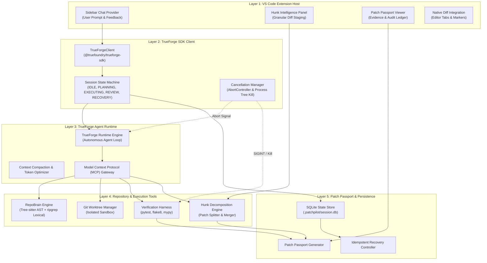
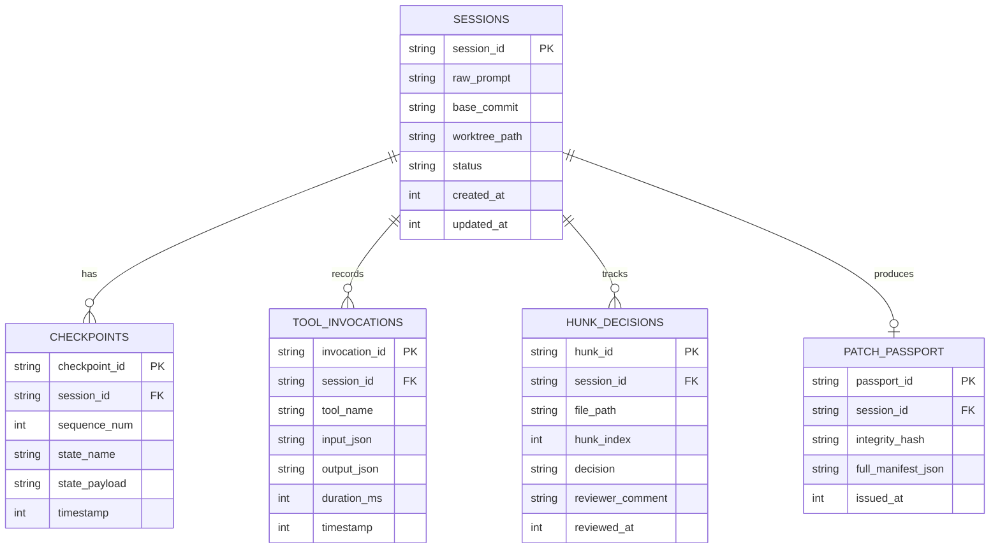

# PatchPilot — System Architecture Specification

## 1. Architectural Philosophy & Principles

PatchPilot is architected around five fundamental software engineering principles:

1. **Isolation by Default:** AI code generation must never mutate the developer's active working tree without explicit human authorization. All operations take place in dedicated, temporary Git worktrees.
2. **TrueForge Sole Loop Authority:** All model-driven reasoning, planning, tool selection, and agent execution cycles are strictly governed by **TrueForge**. PatchPilot provides the editor harness, local tool implementations, and verification evidence, but does not implement an independent agent loop.
3. **Semantic Granularity:** Code changes are treated as discrete, semantic hunks mapped to Abstract Syntax Tree (AST) nodes, rather than opaque, whole-file rewrites.
4. **Empirical Verification:** No code modification is presented as complete without automated verification (unit tests, linter checks, syntax validation) executed inside the isolated sandbox.
5. **Auditable Provenance:** Every generated patch is accompanied by an immutable, structured manifest (the **PatchPassport**) that links user prompt, agent plan, affected symbols, review decisions, and test logs.

---

## 2. Five-Layer Architecture Overview

PatchPilot is structured into five distinct operational layers with explicit boundaries:

---

## 3. Layer Specifications & Component Contracts

### 3.1 Layer 1: VS Code Extension Host
- **Role:** User interface, command registration, and IDE integration.
- **Components:**
  - `ChatViewProvider`: Custom webview in the primary sidebar for prompt entry, progress streaming, and high-level interaction.
  - `HunkReviewPanel`: Webview panel rendering semantic diff hunks with per-hunk actions: `[Accept]`, `[Reject]`, `[Re-prompt]`.
  - `PassportViewer`: Visual inspector for the generated Patch Passport receipt.
  - `CommandController`: Registers VS Code commands (e.g., `patchpilot.startSession`, `patchpilot.cancel`, `patchpilot.openPassport`).
- **Boundary:** Never communicates directly with LLM providers; all actions route through Layer 2.

### 3.2 Layer 2: TrueForge SDK Client
- **Role:** Manages the client-side session lifecycle, handles real-time event streaming, and coordinates cancellation.
- **Components:**
  - `TrueForgeClient`: Interfaces with `@truefoundry/trueforge-sdk`. Connects to the local or remote TrueForge daemon.
  - `SessionStateMachine`: Maintains strict state invariants:
    `IDLE -> PLANNING -> EXECUTING_TOOLS -> VERIFYING -> HUMAN_REVIEW -> COMMITTED / CANCELLED`.
  - `CancellationManager`: Tracks active asynchronous operations and propagates cancellation tokens (`AbortSignal`) to both TrueForge and running local child processes.

### 3.3 Layer 3: TrueForge Agent Runtime
- **Role:** **The sole model-driven execution loop.** 
- **Architectural Mandate:** PatchPilot strictly delegates all autonomous decision-making, planning, and tool invocation to TrueForge. PatchPilot does not contain a fallback or parallel model loop.
- **Capabilities Leveraged:**
  - TrueForge's context compaction algorithms to handle massive repositories (`pallets/flask`).
  - TrueForge's tool execution framework and streaming protocol.
  - Model and provider neutrality (OpenAI, Anthropic, Google Gemini, Ollama, self-hosted LLMs).

### 3.4 Layer 4: Repository & Execution Tools
- **Role:** Local execution capabilities exposed to TrueForge as structured tools.
- **Components:**
  1. **RepoBrain:**
     - **AST Parser:** Tree-sitter bindings for language-specific syntax analysis (classes, functions, method calls, decorator structures).
     - **Lexical Indexer:** `ripgrep` (`rg`) integration for sub-millisecond regex and identifier searches.
     - **Context Relevance Ranker:** Builds a localized symbol graph to identify high-affinity files and symbols for a given prompt.
  2. **Git Worktree Manager:**
     - Clones the target HEAD into `.patchpilot/worktrees/wt-<session_id>`.
     - Validates all file read/write paths to prevent directory traversal outside the worktree sandbox.
     - Generates unified diffs against the base branch (`git diff HEAD`).
     - Prunes worktrees cleanly upon session completion or cancellation.
  3. **Verification Harness:**
     - Dispatches automated test commands (e.g., `pytest tests/test_routing.py`) inside the worktree environment.
     - Parses stdout, stderr, and exit codes into structured diagnostic payloads.
     - Runs linting tools (`flake8`, `mypy`) to catch static defects before review.
  4. **Hunk Decomposition Engine:**
     - Parses standard unified diffs (`git diff`) into individual semantic hunks.
     - Manages selective patch staging via custom `git apply --cached` patch reconstruction.

### 3.5 Layer 5: Patch Passport & Persistence Layer
- **Role:** Audit logging, state persistence, crash recovery, and verification attestation.
- **Components:**
  - `DatabaseManager`: Embedded SQLite database (`.patchpilot/session.db`) managing tables for sessions, plans, tool logs, hunk review decisions, and checkpoints.
  - `PatchPassportGenerator`: Generates the cryptographically hashed JSON manifest attesting to the completed change.
  - `RecoveryController`: On extension startup, inspects SQLite for interrupted sessions and initiates deterministic recovery or safe cleanup.

---

## 4. Data Persistence & Checkpoint Schema

PatchPilot persists session state to an embedded SQLite database (`.patchpilot/session.db`).

---

## 5. Security & Isolation Architecture

1. **Path Traversal Containment:** Every file modification tool call is checked against the worktree root using canonical path resolution (`fs.realpathSync`). Any path containing `..` or resolving outside `.patchpilot/worktrees/wt-<id>` is immediately rejected.
2. **Secret Masking & Sanitization:** RepoBrain automatically ignores `.env`, `*.key`, `id_rsa`, `.git/credentials`, and sensitive config files.
3. **Execution Sandboxing:** Subprocess commands are strictly parameterized (never concatenated raw strings into `bash -c`). Test runner commands are whitelisted to `pytest`, `python -m unittest`, `flake8`, and `mypy`.
4. **Clean Worktree Dismantling:** Worktree cleanup uses `git worktree remove --force` followed by deletion of the temporary session branch, guaranteeing that aborted sessions leave zero untracked git files.
