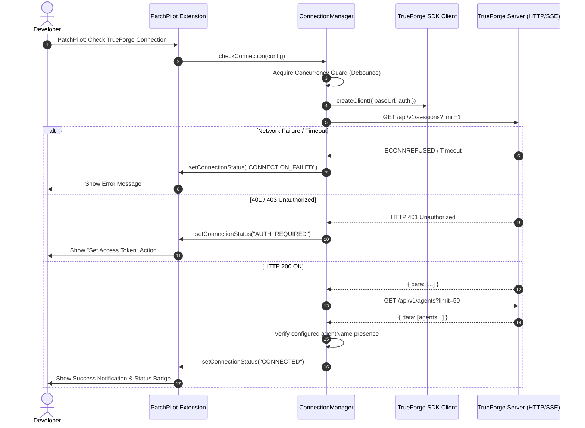

# PatchPilot — Milestone 0: VS Code Extension Skeleton & TrueForge Client Bridge

**Product:** PatchPilot  
**Status:** Milestone 0 Verified & Implemented  
**Repository:** `madhura200227/PatchPilot`  
**Branch:** `feature/milestone-0-extension-skeleton`  
**Starting Commit:** `116e32224f3755ae1a0fb47bac63f998dce4e7d8`  
**Target Harness:** TrueForge SDK (`@truefoundry/trueforge-sdk@0.185.0`)

---

## 1. Extension Architecture

PatchPilot Milestone 0 establishes the production-oriented Visual Studio Code extension skeleton and connects its client presentation layer with the external **TrueForge Agent Runtime**.

### Architectural Separation & Sole Loop Principle

PatchPilot strictly adheres to the **TrueForge Sole Loop Authority**:
- **TrueForge Owns:** The entire model-driven agent loop, LLM provider requests, reasoning and planning, tool selection, tool execution orchestration, session lifecycle, and turn execution.
- **PatchPilot Owns:** VS Code IDE integration, connection management, user input presentation, streaming event classification, incremental UI rendering, cancellation dispatch, and in-memory extension state.
- **Strict Prohibition:** PatchPilot does **not** implement a parallel agent loop, does **not** integrate third-party LLM SDKs (OpenAI, Anthropic, Gemini, Ollama) directly in the extension host, and communicates with models solely via the TrueForge server bridge.

### Component Structure

```text
src/
├── extension.ts                    # VS Code extension activation & lifecycle entrypoint
├── commands/
│   ├── checkConnection.ts          # Command: patchpilot.checkConnection
│   ├── startSession.ts             # Command: patchpilot.startSession
│   ├── sendTestMessage.ts          # Command: patchpilot.sendTestMessage
│   ├── cancelTurn.ts               # Command: patchpilot.cancelTurn
│   ├── showOutput.ts               # Command: patchpilot.showOutput
│   └── tokenCommands.ts            # Commands: patchpilot.setToken & patchpilot.clearToken
├── trueforge/
│   ├── clientFactory.ts            # Typed client instantiation with Bearer / auth: false
│   ├── connectionManager.ts        # Health check, agent discovery, throttle guards
│   ├── sessionManager.ts           # Session lifecycle CRUD with duplicate create protection
│   ├── turnStream.ts               # SSE turn stream consumption, delta aggregation & recovery
│   ├── cancellationManager.ts      # Multi-layer cooperative cancellation (Layer A & Layer B)
│   ├── eventTypes.ts               # Typed event classification & M0 unsupported detection
│   └── errors.ts                   # Strongly-typed domain error hierarchy
├── config/
│   └── configuration.ts            # Settings reader & VS Code SecretStorage bridge
├── state/
│   └── extensionState.ts           # In-memory reactive state machine with concurrency guards
├── output/
│   └── logger.ts                   # Dedicated output channel with token redaction sanitization
└── test/
    ├── testHelpers.ts              # Mock SecretStorage & mock VS Code logger
    ├── setup.ts                    # VS Code API mock hook for Node-based test runners
    ├── unit/                       # 35 unit test specifications across 9 test suites
    └── integration/                # Live server integration test suite against TrueForge daemon
```

---

## 2. Installation and Development Setup

### Prerequisites

- **Node.js:** `v22.0.0` or higher (verified on Node `v24.12.0`).
- **npm:** `v10.0.0` or higher (verified on npm `11.6.2`).
- **Visual Studio Code:** Version `1.101.0` or higher.
- **TrueForge Server Daemon:** Installed and running out-of-process on port 8790.

### Installation Steps

```bash
# 1. Clone repository and checkout the feature branch
git clone https://github.com/madhura200227/PatchPilot.git
cd PatchPilot
git checkout feature/milestone-0-extension-skeleton

# 2. Install pinned dependencies from lockfile
npm install

# 3. Compile TypeScript and bundle production extension
npm run compile

# 4. Execute unit test suite (35 passing unit tests)
npm run test:unit

# 5. Execute live integration test suite against running TrueForge daemon
npm run test:integration
```

---

## 3. Required Node.js Versions & Runtime Findings

### Empirical Findings: Server vs. Extension Host

| Component | Package / Runtime | Minimum Node Engine | Execution Context |
| :--- | :--- | :--- | :--- |
| **TrueForge Server** | `@truefoundry/trueforge@0.185.1` | `>= 22.14.0` | External out-of-process daemon (or Docker container) |
| **TrueForge Client SDK** | `@truefoundry/trueforge-sdk@0.185.0` | `>= 22.0.0` | Bundled in VS Code Extension Host |
| **VS Code Extension Host** | Visual Studio Code `1.101.0+` | Node `22.x` | Bundled Electron 34+ runtime |

### Critical Incompatibility Resolved

Earlier VS Code releases (1.90 through 1.100) executed on Electron 30–32 with bundled Node 20.x. Because `@truefoundry/trueforge-sdk` requires `node >= 22.0.0`, running unbundled SDK code on Node 20 triggers engine warnings and module incompatibilities.

Furthermore, the TrueForge server requires `node >= 22.14.0` and native SQLite/Fastify bindings. Consequently, the TrueForge server **cannot run in-process** inside the VS Code Extension Host. It must run as an external daemon, while the extension connects over HTTP/SSE.

---

## 4. Supported VS Code Version

- **Minimum Supported Version:** `^1.101.0`
- **Engine Declaration (`package.json`):**
  ```json
  "engines": {
    "vscode": "^1.101.0"
  }
  ```
- **Rationale:** VS Code 1.101.0 is the official release that upgraded its extension host to Node 22, satisfying `@truefoundry/trueforge-sdk`'s minimum runtime requirement (`node >= 22.0.0`).

---

## 5. TrueForge Server Setup

PatchPilot does **not** automatically download TrueForge via `npx` or spawn Docker daemons automatically. The developer or environment must start the server independently.

### Running Local TrueForge Standalone Daemon

```bash
# Install TrueForge CLI globally or run via npx with Node >= 22.14.0
npx @truefoundry/trueforge@0.185.1 start --port 8790
```

By default, TrueForge starts in standalone mode using an embedded SQLite database at `http://localhost:8790`.

Verify server readiness:
```bash
curl http://localhost:8790/api/v1/sessions
```

---

## 6. Authentication Setup

TrueForge supports both unauthenticated local standalone mode and token-based bearer authentication.

### Secure Token Management in PatchPilot

1. **Storage:** TrueForge API tokens are stored strictly in **`vscode.SecretStorage`** (`patchpilot.trueforge.token`).
2. **Never in Settings:** Tokens are never stored as plain text settings in `settings.json`.
3. **Never in Logs:** All output written to the PatchPilot Output Channel passes through `sanitizeLog()`, which redacts Bearer tokens, `sk-***` model keys, and auth headers.
4. **Upstream Model Credentials:** Upstream model credentials (such as OpenAI or Anthropic API keys) belong exclusively in TrueForge server configuration (`/api/v1/settings/model-providers`). PatchPilot never prompts for or stores upstream model keys.

### User Commands for Authentication

- `PatchPilot: Set TrueForge Access Token` (`patchpilot.setToken`): Securely prompts for bearer token and saves to `SecretStorage`.
- `PatchPilot: Clear TrueForge Access Token` (`patchpilot.clearToken`): Removes the token from `SecretStorage`.

When no token is stored and local standalone mode is active, the SDK client is initialized with `auth: false` to allow unauthenticated communication.

---

## 7. Agent Configuration

PatchPilot exposes three configuration properties under `patchpilot.trueforge`:

| Setting Key | Type | Default | Description |
| :--- | :--- | :--- | :--- |
| `patchpilot.trueforge.baseUrl` | `string` | `"http://localhost:8790"` | Target TrueForge server endpoint. |
| `patchpilot.trueforge.agentName` | `string` | `""` | Name of the registered agent on the server. |
| `patchpilot.trueforge.requestTimeoutSeconds` | `number` | `30` | Timeout in seconds for TrueForge API requests. |

### Configuration Validation

- If `patchpilot.trueforge.agentName` is empty when `patchpilot.startSession` or `patchpilot.sendTestMessage` is triggered, PatchPilot surfaces a clear actionable error:
  `"PatchPilot: TrueForge agent name is not configured. Please configure 'patchpilot.trueforge.agentName' in settings."` with an **Open Settings** action button.
- During connection checks, PatchPilot queries `/api/v1/agents`. If `agentName` is configured but not registered on the server, a warning badge is displayed with available registered agents.

---

## 8. Connection Flow



---

## 9. Session Lifecycle

Session management is managed through `SessionManager`:

1. **Creation:** Sessions are created via `client.sessions.create({ agent: { name: config.agentName } })`.
2. **ULID Retention:** The returned monotonic ULID (e.g. `01m7mqewpztfqp463t34bpmypf`) is saved to in-memory state (`state.activeSessionId`).
3. **Duplicate Protection:** Accidental repeated execution of `PatchPilot: Start Test Session` reuses the active session unless `forceNew: true` is explicitly requested.
4. **Controlled Teardown:** Sessions can be deleted via `client.sessions.delete(sessionId)`, resetting active session and turn state.
5. **No Premature Persistence:** Milestone 0 uses strict in-memory state; SQLite persistence is deferred to subsequent milestones.

---

## 10. Streaming Behaviour

Turn streaming uses `client.sessions.createTurnStream(sessionId, { input: [...] }, { abortSignal })`.

### Classified Streaming Events

| Event Type | SDK Type | Milestone 0 Handling |
| :--- | :--- | :--- |
| `turn.created` | `TrueForgeApi.TurnCreatedEvent` | Captures monotonic `turnId`, transitions turn status to `RUNNING`. |
| `model.message.delta` | `TrueForgeApi.ModelMessageDeltaEvent` | Streams incremental text chunks directly to PatchPilot Output Channel. |
| `model.message` | `TrueForgeApi.ModelMessageEvent` | Captured without text duplication if deltas were already streamed. |
| `turn.update` | `TrueForgeApi.TurnUpdateEvent` | Logged at debug level. |
| `tool.approval_required` | `TrueForgeApi.ToolApprovalRequiredEvent` | **Detected & reported as unsupported in M0**; transitions turn status to `PAUSED`. |
| `tool.response_required` | `TrueForgeApi.ToolResponseRequiredEvent` | **Detected & reported as unsupported in M0**. |
| `mcp.auth_required` | `TrueForgeApi.McpAuthRequiredEvent` | **Detected & reported as unsupported in M0**. |
| `turn.done` | `TrueForgeApi.TurnDoneEvent` | Extracts terminal status (`done`, `cancelled`, `error`) and telemetry. |

### Text Deduplication Architecture

TrueForge emits an initial `model.message` followed by incremental `model.message.delta` events sharing the same event `id` and `threadId`. `TurnStreamManager` tracks `hasStreamedDeltas`. When deltas are streamed in real time to the output channel, subsequent full `model.message` events are not re-appended, preventing duplicated text.

---

## 11. Cancellation Behaviour

Cancellation is implemented across two distinct operational layers:

```mermaid
flowchart TD
    User([User clicks Cancel Active Turn]) --> Guard{Cancellation Guard}
    Guard -->|Already cancelling| Skip[Ignore duplicate request]
    Guard -->|Acquired| LayerA["Layer A: Client Stream Cancellation<br/>(AbortController.abort())"]
    LayerA --> LayerB["Layer B: Server-Side Turn Cancellation<br/>(client.sessions.cancel(sessionId))"]
    LayerB --> QueryAuth["Query Authoritative State<br/>(client.sessions.getTurn(sessionId, turnId))"]
    QueryAuth --> EvalStatus{Server Status}
    EvalStatus -->|cancelled| MarkCancelled[Status: CANCELLED]
    EvalStatus -->|done| MarkCompleted[Status: COMPLETED (Finished before cancel)]
    EvalStatus -->|error| MarkError[Status: ERROR]
```

### Layer Separation
1. **Layer A (Client Abort):** Dispatches `abortController.abort()`. Stops the local fetch/SSE stream consumer immediately.
2. **Layer B (Server Cancellation):** Dispatches `POST /api/v1/sessions/:id/cancel` via `client.sessions.cancel(sessionId)`. TrueForge halts the model loop and releases server resources.
3. **Graceful Precondition Handling:** If the turn already finished before cancellation reached the server, TrueForge returns HTTP 412 (Precondition Failed). PatchPilot handles this as a graceful terminal state rather than an unhandled error.
4. **No Process Signals:** Milestone 0 does **not** send `SIGINT` or `SIGTERM` to the host process.

---

## 12. Reconnection and Event Recovery

If an SSE stream disconnects mid-turn:
1. PatchPilot retains in-memory state: `sessionId`, `turnId`, `lastEventId`, and `turnStatus`.
2. `TurnStreamManager.recoverTurn()` queries the authoritative server state via `client.sessions.getTurn(sessionId, turnId)`.
3. If the server indicates the turn is already terminal (`done`, `cancelled`, `error`), state is updated immediately. **The user message is never automatically resubmitted.**
4. If the turn is still `"running"`, PatchPilot reconnects using `client.sessions.subscribeToTurn(sessionId, turnId, { fromEventId: lastEventId })`.
5. Streaming resumes from the exact monotonic cursor `fromEventId`, avoiding duplicate output.

---

## 13. Current Limitations & Milestone Boundaries

### Explicitly Excluded from Milestone 0
- **RepoBrain:** No lexical indexing or AST parsing.
- **Git Worktrees:** No worktree creation or branch switching.
- **MCP Servers & File Tools:** No filesystem MCP server, no file editing, no automatic code repair.
- **TrueForge SSRF:** Local MCP server loopback bindings remain unverified and blocked by server SSRF protection.
- **SQLite Persistence:** Session state is strictly in-memory.
- **Hunk Review Panel:** Webview UI is not included; UI is native VS Code commands, status bar, and Output Channel.

---

## 14. Test Execution Instructions

### Running the Full Test Suite

```bash
# 1. Compile TypeScript and build bundles
npm run compile

# 2. Run all unit tests (35 test cases)
npm run test:unit

# 3. Run live integration tests (requires running TrueForge server at localhost:8790)
npm run test:integration
```

### Test Classification Results

| Test Category | Suite Name | Tests | Result | Evidence |
| :--- | :--- | :--- | :--- | :--- |
| **Unit** | `CancellationManager (Layers A & B)` | 3 | **PASS** | AbortSignal firing, server cancel dispatch, 412 handling. |
| **Unit** | `TrueForgeClientFactory` | 2 | **PASS** | Client instantiation with and without API token. |
| **Unit** | `ConfigurationManager & SecretStorage` | 3 | **PASS** | SecretStorage token read/write/clear, default fallback. |
| **Unit** | `ConnectionManager` | 4 | **PASS** | Connected state, missing agent detection, 401 auth, ECONNREFUSED. |
| **Unit** | `Concurrency Guards & Command Protection` | 4 | **PASS** | Duplicate session protection, message guards, status bar text. |
| **Unit** | `Domain Errors` | 4 | **PASS** | Inheritance, error metadata, unsupported M0 event error. |
| **Unit** | `Stream Event Classification` | 5 | **PASS** | turn.created, message deltas, turn.done, unsupported event detection. |
| **Unit** | `Extension Host Lifecycle` | 2 | **PASS** | Clean activate, command registration (7 commands), clean deactivate. |
| **Unit** | `SessionManager` | 5 | **PASS** | Create, reuse, forceNew, missing agent error, delete. |
| **Unit** | `TurnStreamManager & Delta Aggregation` | 3 | **PASS** | Delta streaming, text deduplication, turn recovery. |
| **Integration** | `Health & Connection (Real Server)` | 1 | **PASS** | Real HTTP 200 response from `http://localhost:8790`. |
| **Integration** | `Session Creation (Real Server)` | 1 | **PASS** | Real session created with ULID on server daemon. |
| **Integration** | `Session Retrieval (Real Server)` | 1 | **PASS** | Real session fetched via `client.sessions.get()`. |
| **Integration** | `Turn Streaming (Real Server)` | 1 | **PASS** | Real SSE turn stream consumed; 3 real server events captured. |
| **Integration** | `Cancellation Dispatch (Real Server)` | 1 | **PASS** | Real server cancellation endpoint accepted. |
| **Integration** | `Session Deletion (Real Server)` | 1 | **PASS** | Real session deleted; 404 confirmed post-deletion. |
