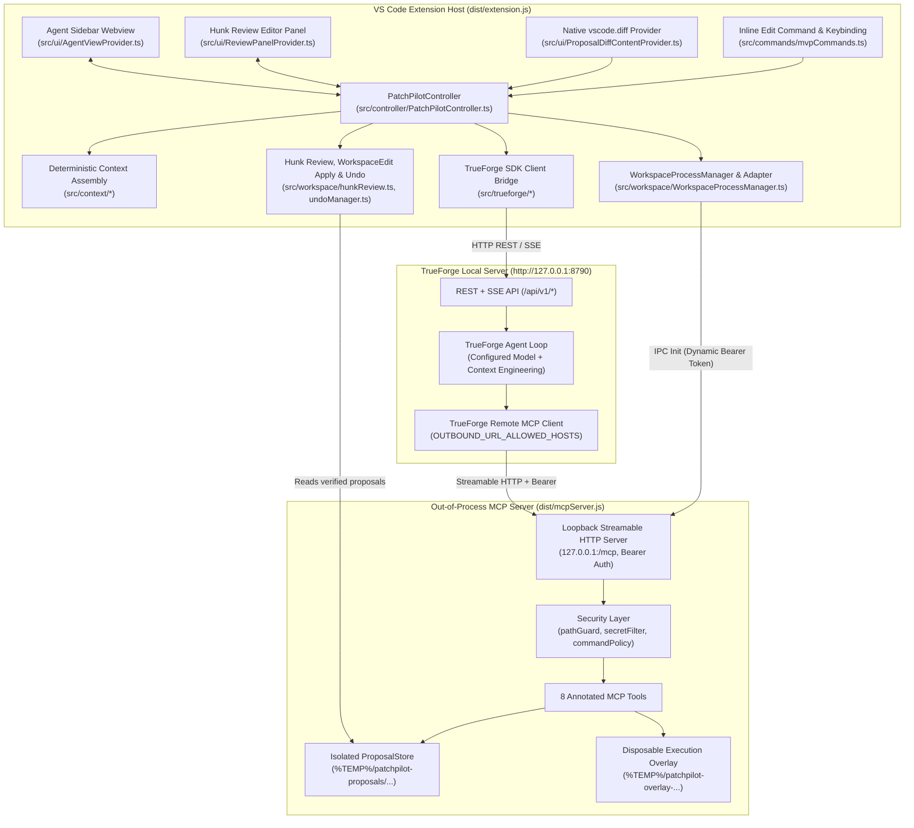

# PatchPilot — MVP Architecture Specification

**Version:** 0.2.0 (Forge-a-thon MVP)  
**Target Host:** Visual Studio Code (`^1.101.0`, Node 22+ Extension Host)  
**Agent Runtime:** TrueForge (`@truefoundry/trueforge@0.185.1`, `@truefoundry/trueforge-sdk@0.185.0`)  
**Workspace Protocol:** Model Context Protocol (`@modelcontextprotocol/sdk@1.32.2`, Streamable HTTP over loopback)

---

## 1. End-to-End System Architecture

PatchPilot strictly enforces **TrueForge Sole Loop Authority**: TrueForge owns all LLM invocations, planning, tool selection, tool dispatch, context compaction, and approval gating. PatchPilot provides the VS Code editor presentation surface, deterministic local context assembly, isolated proposal & hunk review workflow, safe undo, and loopback MCP workspace server.

---

## 2. TrueForge Session Lifecycle

1. **Preflight & Diagnostics (`src/trueforge/connectionManager.ts`):**
   - Verifies server reachability (`sessions.list`), authentication, configured models (`models.list`), registered MCP connectors (`mcpServers.list` + `mcpServers.listTools`), and configured agents (`agents.list`).
   - Classifies exact states: `CONNECTED`, `SERVER_NOT_RUNNING`, `UNSUPPORTED_SERVER_VERSION`, `MODEL_NOT_CONFIGURED`, `AUTH_REQUIRED`, `MCP_CONNECTOR_NOT_REGISTERED`, `AGENT_NOT_CONFIGURED`, `REQUEST_FAILED`.
2. **Agent Registration (`src/trueforge/agentManager.ts`, `agents/patchpilot.agent.json`):**
   - Creates or updates the named `patchpilot` agent using the user's model identifier configured inside TrueForge (never hardcoded).
   - Enables TrueForge context-engineering features:
     - `mcpServers[0].preload = false` (deferred tool schema loading)
     - `config.contextManagement.compaction.enabled = true`
     - `config.contextManagement.largeToolResponse.enabled = true`
     - `mcpServers[0].requireApprovalForTools = ["propose_edit", "run_workspace_command"]`
3. **Session & Turn Streaming (`src/trueforge/sessionManager.ts`, `src/trueforge/turnStream.ts`):**
   - Creates/reuses a TrueForge session and locks the active VS Code workspace folder for the turn's duration.
   - Streams SSE events via `sessions.createTurnStream(...)` with monotonic event ID deduplication.
   - Separates natural-language deltas (`model.message.delta`) from tool activity (`model.message.toolCalls` and `tool.response`).
4. **Human-in-the-Loop Tool Approvals (`src/trueforge/approvalManager.ts`):**
   - Listens for `tool.approval_required`, correlates `ToolCallRef.id` to the exact tool name and arguments, surfaces Approve/Deny controls in the Agent panel, submits `user.tool_approval` via `sessions.createTurnEvents(...)`, and resumes streaming via `sessions.subscribeToTurn(sessionId, turnId, { afterEventId })`.

---

## 3. MCP Tool Flow

The out-of-process server (`dist/mcpServer.js`) binds strictly to `127.0.0.1` on an ephemeral port, receives its per-process cryptographic Bearer token via Node IPC (never CLI args), supports multiple concurrent/sequential MCP sessions via per-session `StreamableHTTPServerTransport`, and exposes 8 annotated tools:

| Tool | MCP Annotations | Behavior |
|---|---|---|
| `get_workspace_status` | `readOnlyHint: true` | Branch, clean/dirty porcelain status, pending proposal summary |
| `list_workspace_files` | `readOnlyHint: true` | Bounded listing excluding `.git`, secrets, symlinks, vendor dirs |
| `search_workspace` | `readOnlyHint: true` | Deterministic BM25 + path-token search returning ranked snippets |
| `read_workspace_file` | `readOnlyHint: true` | Safe UTF-8 text read with SHA-256 and optional line slice |
| `read_workspace_symbol` | `readOnlyHint: true` | Function/class/method/interface/doc heading lookup with snippet |
| `get_context_plan` | `readOnlyHint: true` | Explains selected files, rationale, and remaining estimated budget |
| `propose_edit` | `readOnlyHint: false` | Explicit `mode: "range"` (inline edit: splices `replacement` between preserved prefix & suffix with 6 invariants) or `mode: "full_file"` (Agent Mode / new files) in isolated `ProposalStore` (never writes workspace) |
| `run_workspace_command` | `destructiveHint: true` | Runs allowlisted command in disposable overlay containing staged proposals |

---

## 4. Context Assembly Flow (`src/context/`)

- **Explicit Mentions (`mentionParser.ts`):** Extracts `@file:path`, `@symbol:name`, and shorthand `@path/file.ext`. Unknown or blocked references are surfaced explicitly rather than ignored.
- **Symbol Resolution (`symbolResolver.ts`):** Queries VS Code's `vscode.executeWorkspaceSymbolProvider` when available, with deterministic lexical fallback for Python, TypeScript/JavaScript, and RST/Markdown headings.
- **Automatic Retrieval (`relevanceRanker.ts`):** Computes deterministic BM25 (`k1=1.5, b=0.75`) plus path-token boundary and term-coverage boosts across eligible workspace files, extracting merged line-numbered snippets and selection reasons.
- **Measurable Budget (`tokenBudget.ts`, `contextAssembler.ts`):** Enforces a configurable budget (default `16,000` estimated token-equivalents at ~4 UTF-8 bytes/token, clearly labeled as an estimate). Prioritizes user request -> explicit `@file` -> explicit `@symbol` -> workspace overview -> ranked automatic snippets, recording excluded/truncated items.
- **TrueForge Context Engineering:** Pairs local budgeted retrieval with TrueForge deferred tool loading (`preload: false`), context compaction, and large tool-response offloading so repositories larger than a model's context window remain tractable.

---

## 5. Inline Edit & Multi-File Proposal Flows

- **Inline Edit (`patchpilot.inlineEdit`, `Ctrl+Shift+I` / `Cmd+Shift+I`, explicit `mode: "range"`):**
  1. Checks for unsaved buffer edits (`doc.isDirty`) and captures an immutable `InlineEditContext` (`src/workspace/rangeEdit.ts`) with workspace-relative path, zero-based UTF-16 `range` (`start`/`end` line + character), exact UTF-16 `startOffset`/`endOffset`, verbatim `selectedText`, EOL style (`\r\n`/`\n`), `originalVersion`, and full-file `originalSha256`.
  2. Registers `InlineEditContext` on the MCP server/ProposalStore; any attempt to call `propose_edit(mode="full_file")` on that file during an active inline edit is rejected hard (`FULL_FILE_REJECTED_IN_INLINE_EDIT`).
  3. Sends a TrueForge range-edit prompt instructing `propose_edit(mode="range", replacement=...)` for ONLY the selected region.
  4. `applyRangeReplacement()` verifies file SHA-256 and selection boundaries (Invariant 3), rejects empty/truncated/fenced/accidental-full-file replacements (Invariant 4), mechanically splices `prefix + normalizedReplacement + suffix` preserving exact code-unit-for-code-unit prefix and suffix (Invariants 1 & 2), and requires explicit `expandedRange` + `expansionReason` if lines outside the selection must change (Invariant 6).
  5. Stores the reconstructed full-file proposal strictly in temporary proposal storage (Invariant 5) and renders the localized diff hunk in the Review panel with a `RANGE EDIT` + `PREFIX/SUFFIX PRESERVED` badge (or explicit Selection Expansion Notice if expanded).
- **Multi-File Agent Mode (`patchpilot.startAgentRun` / Agent Panel):**
  1. When no files are mentioned by the user, PatchPilot does **not** inject guessed filenames into the prompt; TrueForge independently invokes `search_workspace`, `get_context_plan`, and `read_workspace_file` to discover target files.
  2. Multiple `propose_edit` calls accumulate per-file proposals in isolated temporary storage (`%TEMP%/patchpilot-proposals/...`).
  3. Calling `run_workspace_command` materializes active proposals into a disposable overlay (`%TEMP%/patchpilot-overlay-...`), prepending `overlay/src` to `PYTHONPATH` for Python src-layout repos, runs allowlisted tests, and deletes the overlay in `finally`.

---

## 6. Hunk Review, Safe Apply & Undo Flow

1. **Diff Decomposition (`src/workspace/patchEngine.ts`):** Computes Myers/LCS line diffs grouped into discrete `DiffHunk[]` blocks preserving EOL style (`\r\n` vs `\n`).
2. **Hunk Decisions (`src/ui/ReviewPanelProvider.ts`):** Users toggle **Accept Hunk** or **Reject Hunk** per hunk (or inspect side-by-side via native `vscode.diff`).
3. **Explicit Apply (`src/workspace/hunkReview.ts`, `src/workspace/vscodeMutations.ts`):**
   - Revalidates every target path (`rejectSymlinks: true`).
   - Verifies current file SHA-256 matches `proposal.originalSha256` (or confirms non-existence for new files); marks changed files `stale` and refuses silent overwrite.
   - Reconstructs patched content via `applySelectedHunks()` (only accepted hunks applied; rejected/pending hunks untouched).
   - Writes through `vscode.WorkspaceEdit` and saves documents.
   - Records an `UndoBatch` with pre-apply content and pre/post SHA-256 hashes.
4. **Safe Undo (`src/workspace/undoManager.ts`, `patchpilot.undoLastApply`):**
   - Verifies every file in the last applied batch still matches `afterSha256` before mutating anything.
   - Refuses undo with explicit conflict listing if the user edited files after PatchPilot applied changes.
   - Restores modified files and deletes PatchPilot-created new files through `vscode.WorkspaceEdit`.

---

## 7. Cancellation, Error Handling & Resilience

- **Cancellation (`src/trueforge/cancellationManager.ts`):**
  1. Dispatches authoritative server-side cancellation (`POST /api/v1/sessions/:id/cancel`) first.
  2. Cancels pending human approvals and sends `POST /control/cancel` to the local MCP process to terminate running command subprocess trees (`taskkill /T /F` on Windows, `SIGTERM`/`SIGKILL` on POSIX) and discard unaccepted pending proposals for the cancelled run.
  3. Polls `sessions.getTurn()` for terminal status confirmation (`cancelled` / `done` / `error`).
  4. Aborts the local client SSE `AbortController`.
- **Resilience (`src/trueforge/turnStream.ts`):**
  - Retries ONLY transient transport/5xx/429 failures using bounded exponential backoff (`maxRetries = 2`).
  - Never retries 401/403 authentication errors or 400/422 validation errors.
  - Failed turns never mutate workspace files and keep VS Code fully responsive.

---

## 8. Security Boundaries & Residual Risks

- **Loopback + Per-Process Auth:** MCP server binds strictly to `127.0.0.1` and validates `Authorization: Bearer <token>` with `crypto.timingSafeEqual` on all `/mcp` and `/control/*` routes.
- **Hardened Path Confinement (`src/security/pathGuard.ts`):** Rejects `../`, absolute paths, Windows drive letters, UNC paths, null bytes, protected directories (`.git`, `.ssh`, `.aws`, `node_modules`, `.venv`, `.patchpilot`), binary files, oversized (>1 MiB) files, disallowed executables, symlinks escaping root, and **unlisted dotfiles** (closed the Prompt 005 blanket dotfile bypass via `ALLOWED_DOTFILES`).
- **Command Allowlist (`src/security/commandPolicy.ts`):** Replaces Prompt 005's broad `node --test <any file>` check with strict per-executable argument policies for `pytest`, `python`/`python3` (`-m pytest|unittest|flask` only), `flask`, `node --test <approved test target>`, approved `npm` scripts, and read-only `git`, always running with `shell: false`, sanitized env (`sanitizeProcessEnv`), 64 KiB output cap, timeout, and `AbortSignal` tree kill.
- **SSRF Protection:** TrueForge SSRF guard remains enabled (`NETWORK_POLICY_ENABLED` untouched); local development uses only the narrow loopback allowlist `OUTBOUND_URL_ALLOWED_HOSTS='["127.0.0.1","localhost"]'`.
- **TOCTOU Residual Risk:** `safeReadWorkspaceTextFile` uses `O_NOFOLLOW` on POSIX and performs post-open `realpath` verification; on Windows (where `O_NOFOLLOW` is unavailable in Node `fs.open`), a narrow OS-level race window remains if an untrusted local process concurrently swaps a file with a reparse point between open and read. Workspace Trust gating and isolated temp overlays mitigate this boundary.
