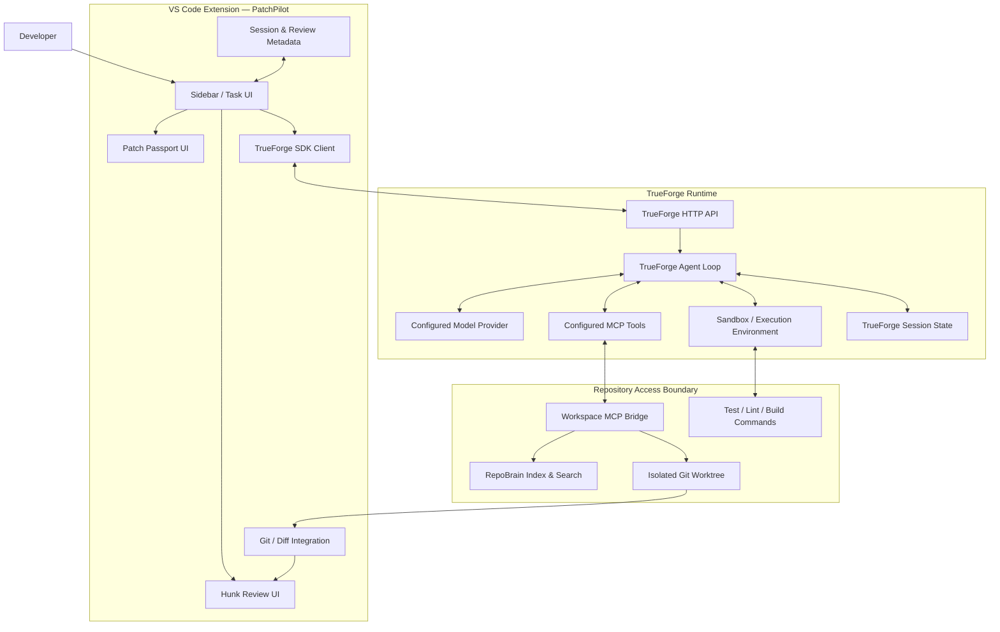
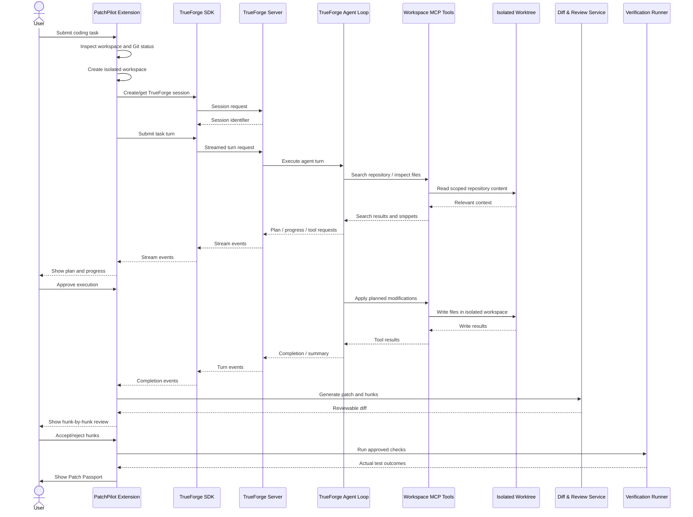
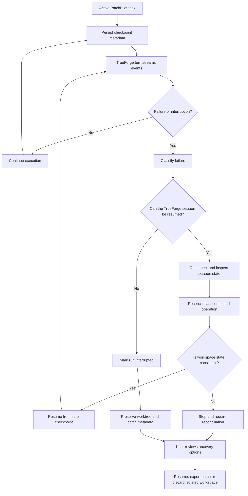
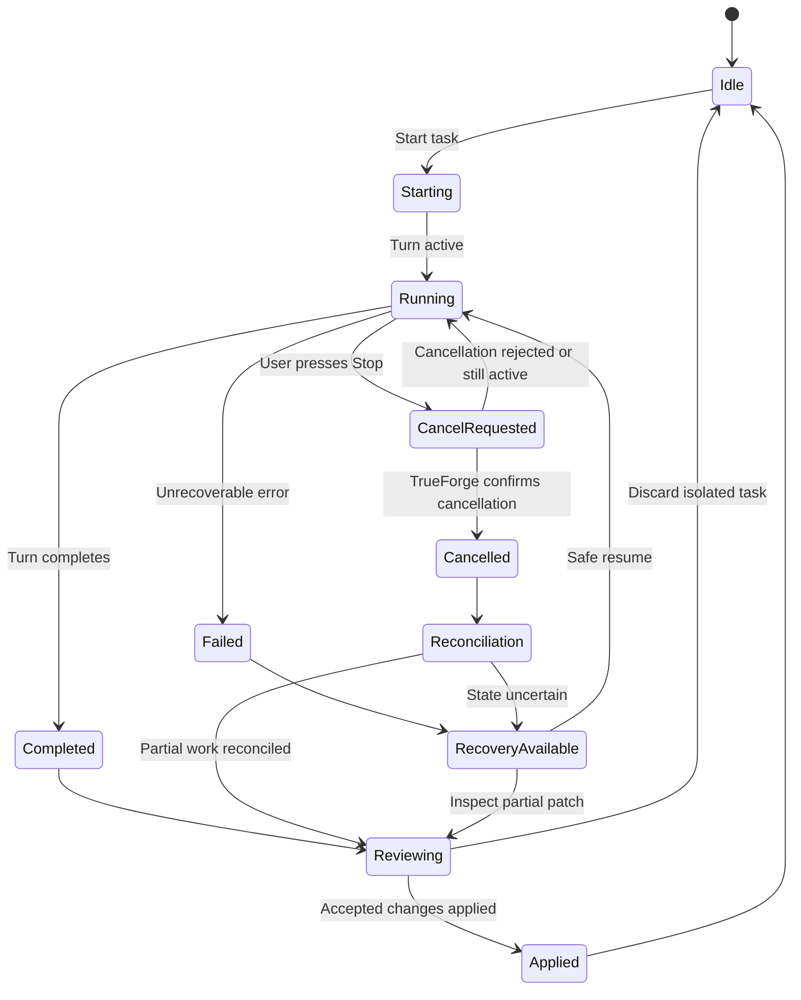
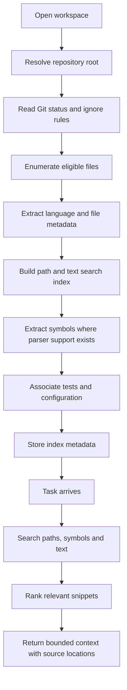
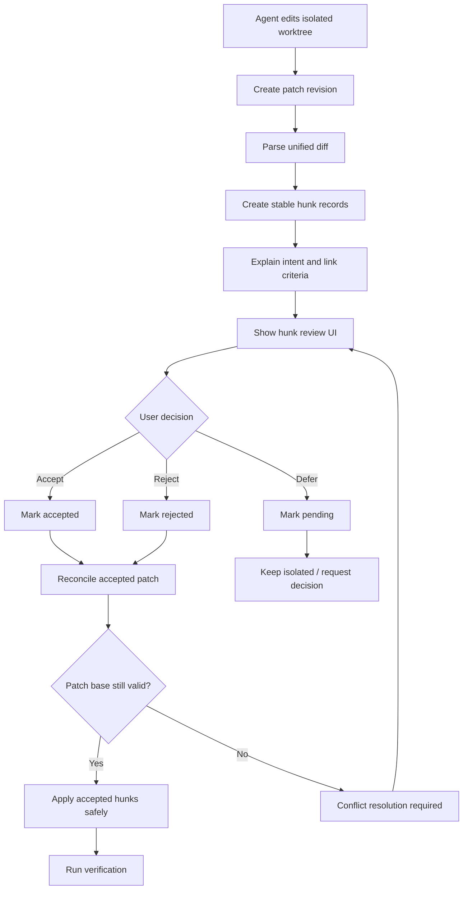

# PATCHPILOT

## Product Requirements Document (PRD v0.1.0) & Initial Technical Design

> **DOCUMENTATION AUTHORITY LEVEL: 1 (PRIMARY PRODUCT REQUIREMENTS)**  
> This document (`docs/PRD.md`) is the primary source of truth for PatchPilot product requirements, user journeys, functional specifications, and MVP acceptance criteria.  
> Hierarchy of authority: (1) `docs/PRD.md` > (2) [docs/ARCHITECTURE.md](file:///e:/MADHURA/PROJECTS%20madhura/PatchPilot/docs/ARCHITECTURE.md) > (3) [docs/WORKFLOWS.md](file:///e:/MADHURA/PROJECTS%20madhura/PatchPilot/docs/WORKFLOWS.md) > (4) [docs/COMPETITION_COMPLIANCE.md](file:///e:/MADHURA/PROJECTS%20madhura/PatchPilot/docs/COMPETITION_COMPLIANCE.md) > (5) [README.md](file:///e:/MADHURA/PROJECTS%20madhura/PatchPilot/README.md) > (6) [PATCHPILOT_INITIAL_ENGINEERING_DOCUMENTATION.md](file:///e:/MADHURA/PROJECTS%20madhura/PatchPilot/PATCHPILOT_INITIAL_ENGINEERING_DOCUMENTATION.md).

**Document type:** Product Requirements Document + Initial Technical Design  
**Version:** 0.1.0  
**Status:** Authoritative Product Requirements --- frozen pending official competition task release and team review  
**Competition:** TrueFoundry Forge-a-thon, Techfest, IIT Bombay  
**Prepared:** 17 November 2026  
**Target:** VS Code extension-native AI coding agent powered by TrueForge  
**Working product name:** PatchPilot  

------------------------------------------------------------------------

# 1. Executive Summary

PatchPilot is a VS Code-native AI coding agent designed to make repository-scale code changes safely, transparently and verifiably.

It is not intended to be another chat interface that returns code snippets. It should understand a repository, plan a multi-file change, execute that work through TrueForge, present reviewable Git diffs, run relevant verification and recover safely from interrupted or failed model operations.

Its central product promise is:

> Every AI-generated code change should have a reason, a reviewable diff and verification evidence.

The product's signature experience is the **Patch Passport**: a structured record connecting the user's request, the plan, affected files, individual diff hunks, approvals, test results and recovery events.

**Non-negotiable architecture constraint:** TrueForge owns the model-driven agent execution loop. The VS Code extension must act as the editor client and workflow surface. It must not run a second, hidden model/tool orchestration loop.

## 1.1 Product Identity

- **Name:** PatchPilot
- **Category:** VS Code-native AI coding agent
- **Runtime:** TrueForge
- **Primary interface:** VS Code extension
- **Primary repository demonstration:** `pallets/flask`
- **Signature feature:** Patch Passport with hunk-level evidence and recovery history

## 1.2 Product Vision

Build a coding agent that does not merely generate code, but makes repository-wide changes understandable, reviewable, recoverable and testable.

## 1.3 Core Value Proposition

| Conventional coding assistant | PatchPilot |
| :--- | :--- |
| Responds with code or edits | Understands repository context before editing |
| Often edits files as it reasons | Creates a plan before execution |
| Shows a broad final diff | Explains and reviews individual hunks |
| Reports tests informally | Links verification results to the change |
| Can lose progress after failure | Persists checkpoints and recovery metadata |
| Cancellation may be unclear | Exposes and verifies TrueForge cancellation |

------------------------------------------------------------------------

# 2. Competition Understanding and Compliance

## 2.1 Officially Listed Competition Facts

The official Techfest competition page identifies the event as the **TrueFoundry Forge-a-thon**, organized by Techfest, IIT Bombay, in partnership with TrueFoundry.

| Item | Officially listed information |
| :--- | :--- |
| Eligibility | Participants aged 18 or older |
| Team size | Up to 5 members |
| Registration window | 15 October--15 November 2026 |
| Round 1 deadline | 20 November 2026, 23:59 IST |
| Round 1 results | 30 November 2026 |
| Round 2 finals | 16--18 December 2026 |
| Prize pool | ₹3,00,000 |
| Round 1 demo | Maximum 4 minutes |
| Round 1 repository | Public GitHub repository |
| Round 1 write-up | PDF, 1--3 pages |
| Round 1 video | Public demo video showing Tasks A, B and C on `pallets/flask` |

Official source: <https://techfest.org/competitions/forge-a-thon>

## 2.2 Explicit Rules Identified on the Official Page

1. Agent loops must run strictly on TrueForge.
2. Teams must register online through Techfest and obtain a Team ID.
3. Code must be original or use properly licensed open-source forks.
4. Models must be configured through TrueForge.
5. Models used must be declared in the submission write-up.
6. Judges' decisions are final and binding.

These are competition requirements, not optional product preferences.

## 2.3 Core Product Capabilities Identified by the Competition

PatchPilot must demonstrate:

- Understanding and navigating large code repositories.
- Autonomous, unprompted multi-file code modifications.
- Hunk-by-hunk diff review.
- Reliable operation under model failures.
- An agent loop executed strictly through TrueForge.
- Immediate cancellation capability, as emphasized in the Techfest competition listing.
- Three fixed first-round tasks on `pallets/flask`.

## 2.4 Round 1 Deliverables

- Public GitHub repository.
- A 1--3 page PDF write-up.
- A public demo video of no more than four minutes.
- A demonstration of Tasks A, B and C against `pallets/flask`.

## 2.5 Rules and Details Requiring Organizer Confirmation

The publicly accessible competition page does not establish the complete technical specification. The team must obtain and preserve the latest organizer-issued instructions for:

- Exact wording and acceptance criteria for Tasks A, B and C.
- Detailed judging rubric and scoring weights.
- Required repository branch, tag or commit conventions, if any.
- Exact submission portal fields and upload procedure.
- Whether the evaluation environment permits a local, self-hosted or remote TrueForge server.
- Network access, model-provider and API-key restrictions during evaluation.
- Any additional Round 2 live-coding or harness-contribution instructions.
- Whether the organizers have issued updates after the published page was reviewed.

**Do not invent missing rules.** The latest official Techfest page and organizer announcements take precedence over this document. Submit technical questions through the official competition portal's designated channel.

## 2.6 Compliance Matrix

| Requirement | Planned implementation | Evidence to retain |
| :--- | :--- | :--- |
| TrueForge-only agent loop | SDK client creates sessions and streams turns from TrueForge | Architecture, code references, runtime logs |
| Models configured through TrueForge | No model credentials or direct model SDK in extension | TrueForge configuration and model declaration |
| Public repository | Publish source and setup instructions | Public repository URL |
| Original or properly licensed code | Original PatchPilot implementation; license audit for dependencies/forks | Dependency and attribution inventory |
| Large-repository understanding | Repository indexing and retrieval tools | Flask task recordings and retrieval traces |
| Multi-file modifications | Planned edits through TrueForge-connected tools | Git diff and task recordings |
| Hunk-level review | Individual hunk review and approval state | Review walkthrough |
| Failure handling | Checkpoint, retry and resume workflow | Reproducible failure test |
| Cancellation | Stop action mapped to TrueForge cancellation | Cancellation test and event log |
| Model disclosure | List configured model/provider in write-up | Final PDF |
| Four-minute demo | Recorded timed walkthrough | Final public video |

## 2.7 Source-of-Truth Policy

When information conflicts, apply this order:

1. Latest official organizer instructions and clarifications.
2. Official competition page.
3. Official TrueForge documentation and source repository for runtime behavior.
4. This engineering document.
5. Team assumptions and proposals.

This document must be updated when official task prompts or clarifications are received.

------------------------------------------------------------------------

# 3. Problem Statement

Developers working in large repositories need more than code generation. A meaningful task can affect multiple modules, tests, configuration files and documentation. A coding agent must identify the correct context, reason about dependencies, make coherent changes and provide a safe review process.

Uncontrolled agent editing creates several risks:

- Relevant files may be missed.
- Unrelated files may be modified.
- Existing uncommitted user work may be overwritten.
- Partial edits may remain after a model or tool failure.
- Tests may not cover the actual change.
- Reviewers may not understand why a hunk exists.
- A Stop action may stop the UI but not the active agent execution.

PatchPilot addresses these risks with repository intelligence, explicit planning, isolated execution, reviewable patches, verification and recoverable sessions.

------------------------------------------------------------------------

# 4. Product Objectives and Success Criteria

## 4.1 Primary Objectives

1. Deliver a usable VS Code extension.
2. Use TrueForge as the sole model-driven agent runtime.
3. Understand and retrieve relevant context from a large repository.
4. Execute multi-file changes for natural-language tasks.
5. Preserve the developer's original workspace and uncommitted changes.
6. Review and approve/reject changes at individual hunk level.
7. Run relevant tests and report their actual outcomes.
8. Cancel active agent execution.
9. Recover safely from model, stream, tool or process failures.
10. Demonstrate all three official Flask tasks reproducibly.

## 4.2 Measurable Acceptance Goals

These are proposed engineering acceptance targets, not official judging metrics:

- Every agent turn is initiated and executed through TrueForge.
- Every proposed file modification is attributable to a task/session.
- Every displayed hunk has a stable review identity within its patch revision.
- A rejected hunk is not silently reintroduced during final application.
- Cancellation prevents subsequent writes after cancellation is confirmed.
- A failed or interrupted run can be identified as incomplete rather than falsely marked successful.
- Test results distinguish passed, failed, skipped, cancelled and not-run.
- A task can be repeated from a clean fixture with documented steps.
- All three official tasks pass the team's recorded acceptance checks.

## 4.3 Non-Goals for the First Round

- Building a general-purpose IDE.
- Replacing the VS Code editor or Git interface.
- Supporting every language equally.
- Building a custom foundation model.
- Implementing a separate LLM orchestration framework.
- Adding voice coding, marketplace monetization or team analytics.
- Claiming guaranteed correctness or zero-defect code.

------------------------------------------------------------------------

# 5. Target Users and Primary Use Cases

## 5.1 Primary User

A software developer working in a repository who wants an AI agent to perform a multi-file engineering task while retaining control over the final changes.

## 5.2 Core Use Cases

### UC-01: Understand a repository
The user opens a repository and asks PatchPilot to explain its structure or locate the implementation of a feature. PatchPilot retrieves relevant files, symbols and references rather than sending the entire repository indiscriminately.

### UC-02: Plan a code change
The user submits a natural-language task. PatchPilot returns a plan with likely files, affected components, acceptance criteria and proposed verification steps before editing.

### UC-03: Execute a multi-file change
After the user starts execution, TrueForge runs the agent loop and invokes configured tools to inspect and modify an isolated workspace.

### UC-04: Review individual hunks
PatchPilot displays the generated diff. The user can inspect, accept or reject each hunk and understand its purpose.

### UC-05: Verify a patch
The agent runs relevant tests, linting or other project checks through approved execution tools. Results are associated with the patch revision.

### UC-06: Recover from failure
If a model call, stream, tool or process fails, PatchPilot records the state, identifies completed work and offers a safe resume or restart path.

### UC-07: Stop execution
The user presses Stop. PatchPilot requests cancellation from TrueForge, updates the session state based on the actual result and prevents additional writes from continuing unnoticed.

------------------------------------------------------------------------

# 6. Functional Requirements

Priority definitions:
- **P0:** Required for a credible competition MVP.
- **P1:** Important differentiator after the P0 path works.
- **P2:** Optional enhancement.

## 6.1 VS Code Extension Shell --- P0

- Activate when a workspace is open.
- Provide a dedicated PatchPilot activity-bar view or sidebar.
- Provide a task input and conversation timeline.
- Display connection and runtime status.
- Expose Start, Stop and session recovery actions.
- Use native VS Code diff/editor surfaces where practical.
- Keep long-running operations out of blocking UI handlers.

## 6.2 TrueForge Connection --- P0

- Connect to a configured TrueForge server.
- Use the official `@truefoundry/trueforge-sdk` TypeScript client.
- Create or retrieve a session using supported SDK/API operations.
- Submit user turns through TrueForge.
- Consume streamed events and render execution progress.
- Handle authentication only according to the server's configured mode.
- Surface server errors, timeouts and disconnected streams.
- Use TrueForge's cancellation capability for active turns.
- Avoid direct model-provider calls from the extension.

The precise SDK methods and event types must be checked against the installed SDK version and its matching API reference before implementation.

## 6.3 RepoBrain --- Repository Intelligence --- P0/P1

### Responsibilities
- Discover workspace root and repository metadata.
- Respect `.gitignore` and configured exclusions.
- Exclude generated files, dependencies, binaries and secrets.
- Build a file/directory inventory.
- Search using `ripgrep` or an equivalent local search tool.
- Extract symbols and references using language-aware parsers where available.
- Retrieve relevant snippets with file path and line-range metadata.
- Refresh or invalidate stale index entries after changes.

### Retrieval strategy
Use a staged approach:
1. Repository metadata and directory structure.
2. Filename and path search.
3. Text search.
4. Symbol/reference lookup where supported.
5. Focused snippets around relevant lines.
6. Tests and configuration associated with the selected code.

Do not claim a complete semantic dependency graph unless the implementation actually builds and validates one.

## 6.4 Intent-to-Plan Engine --- P0

Before code modification, produce a structured plan containing:
- User request.
- Task interpretation.
- Acceptance criteria.
- Files expected to change.
- Relevant symbols or modules.
- Dependency and compatibility concerns.
- Tests likely to be required.
- Risks and assumptions.
- Proposed execution steps.

The plan must be reviewable. The user should be able to revise or approve it before execution.

## 6.5 Isolated Multi-File Editing --- P0

- Preserve the original working tree.
- Detect pre-existing modified and untracked files.
- Prefer a dedicated Git worktree or another verified isolated workspace.
- Associate every edit with a PatchPilot session and patch revision.
- Generate a complete diff before applying changes to the user's workspace.
- Avoid overwriting user modifications.
- Detect conflicts before final application.
- Never silently discard work.

If a repository cannot support the preferred isolation strategy, fail safely or ask the user for an explicit alternative.

## 6.6 Hunk Intelligence --- P0

For each hunk, display:
- File path.
- Old and new line ranges.
- Added and removed lines.
- Explanation of intent.
- Related acceptance criterion.
- Relevant test or verification evidence, if available.
- Review status.

Supported review actions:
- Accept hunk.
- Reject hunk.
- Accept all.
- Reject all.
- Reopen or inspect the complete file diff.

Hunk review state must be tied to a specific patch revision. If a new agent edit changes the patch, invalidate or reconcile affected review decisions rather than silently carrying them forward.

## 6.7 Verification Engine --- P0

- Identify project test commands from repository configuration and documentation.
- Show the exact command before execution when approval is required.
- Execute commands in the isolated environment.
- Capture exit code, stdout, stderr and duration.
- Associate results with the patch revision.
- Distinguish passed, failed, skipped, cancelled and not-run.
- Never report an unexecuted test as passed.
- Allow targeted tests first, followed by broader checks when appropriate.

## 6.8 Crash Recovery Engine --- P1

Persist enough metadata to recover safely:
- PatchPilot session ID.
- TrueForge session and turn identifiers, where available.
- Task and plan revision.
- Workspace and worktree identity.
- Patch revision and patch hash.
- Completed tool operations.
- Current execution status.
- Last processed event/cursor if supported.
- Hunk review decisions.
- Verification results.
- Failure classification and timestamps.

Recovery must be idempotent where possible. Replaying an operation must not duplicate a completed write or corrupt the worktree.

## 6.9 Patch Passport --- P1

Generate an evidence-oriented task summary:
- User request.
- Plan and acceptance criteria.
- Files changed.
- Hunk inventory and review decisions.
- Tests and commands executed.
- Actual test outcomes.
- Failed or skipped checks.
- Model/runtime information available for disclosure.
- Recovery and cancellation history.
- Remaining risks and unresolved items.

The Patch Passport must clearly label unavailable evidence. It must not invent verification.

## 6.10 Cancellation --- P0

- Stop button must be visible during active execution.
- Stop action must invoke the supported TrueForge cancellation operation.
- UI must distinguish cancellation requested from cancellation confirmed.
- Stop further local write/apply operations when cancellation is requested.
- Reconcile the actual workspace state after cancellation.
- Preserve already completed work and mark incomplete work accurately.
- Do not show a successful cancellation merely because the button was clicked.

------------------------------------------------------------------------

# 7. System Architecture

## 7.1 Architecture Principles

1. TrueForge owns the model-driven agent loop.
2. The extension is a client, not a competing agent runtime.
3. Repository access is explicit, scoped and auditable.
4. Execution happens in an isolated workspace wherever practical.
5. Review decisions are deterministic and persisted outside transient UI state.
6. Verification results are factual and tied to a patch revision.
7. Cancellation and recovery are first-class lifecycle operations.
8. Every important operation has a clear failure state.

## 7.2 Architecture Diagram --- System Context



**Boundary note:** The exact repository-to-sandbox transport is an implementation decision that must be validated. A secured workspace MCP bridge, a synchronized worktree or a supported sandbox workspace mount may be used. The chosen design must not create a second model-driven loop outside TrueForge.

## 7.3 Component Responsibilities

| Component | Responsibility | Must not do |
| :--- | :--- | :--- |
| VS Code UI | User interaction, task display, progress, review | Run model reasoning |
| SDK client | Connect, create turns, stream events, cancel | Implement its own agent loop |
| TrueForge | Model calls, tool routing, session lifecycle, approvals, context management | Be bypassed for agent execution |
| RepoBrain tools | Search, inventory, retrieve repository context | Expose secrets or unrestricted filesystem access |
| Workspace bridge | Enforce scoped file and Git operations | Trust arbitrary paths from model output |
| Isolated worktree | Hold proposed edits | Modify the original tree unexpectedly |
| Diff/review service | Create hunks and apply review decisions | Lose review history silently |
| Verification runner | Execute approved checks and capture results | Claim success without execution |
| Metadata store | Persist PatchPilot-specific recovery/review state | Store model secrets |

## 7.4 TrueForge Integration Contract

The extension should use the official TypeScript SDK package:

```bash
npm install @truefoundry/trueforge-sdk
```

Illustrative connection and streaming pattern:

```ts
import { TrueForge } from "@truefoundry/trueforge-sdk";

const client = new TrueForge({
  baseUrl: process.env.TRUEFORGE_BASE_URL ?? "http://localhost:8790",
  // Supply token only when required by the configured server.
});

// Use the SDK's supported session and turn methods.
// Consume the returned async event stream.
// Map actual SDK events to PatchPilot UI state.
```

This is an integration illustration, not a complete implementation. Confirm exact method signatures, event discriminators, cancellation endpoints and error behavior against the pinned SDK/API version.

**Forbidden architecture shortcut:** Calling an LLM directly from a VS Code command handler, then manually looping over tool calls, would violate the intended TrueForge-only agent-loop architecture.

## 7.5 Repository Workspace Strategy

Preferred execution sequence:

1. Inspect Git status.
2. Record the original branch and worktree state.
3. Create an isolated worktree or equivalent isolated workspace.
4. Expose only the required workspace operations to TrueForge.
5. Let the TrueForge agent use configured tools to inspect and modify that workspace.
6. Generate patch revisions and hunk identities.
7. Review and verify the patch.
8. Apply accepted changes to the original workspace only through a controlled, conflict-aware operation.

If the original workspace changes during the task, re-check the base revision and detect conflicts before applying accepted changes.

------------------------------------------------------------------------

# 8. Architecture Deep Dive --- Execution and Data Flow

## 8.1 Task Execution Sequence



## 8.2 Failure and Recovery Sequence



The diagram describes the proposed recovery policy. Actual resume behavior depends on the supported TrueForge session APIs and the durability of the workspace bridge.

## 8.3 Cancellation State Flow



Cancellation requested and cancellation confirmed are separate states.

------------------------------------------------------------------------

# 9. Repository Intelligence --- RepoBrain

## 9.1 Purpose

RepoBrain provides focused repository context to the TrueForge agent through configured tools. It is not a separate agent.

## 9.2 Indexing Pipeline



## 9.3 Index Exclusions

At minimum, exclude or carefully filter:

- `.git/`
- `node_modules/`
- Virtual environments.
- Build and distribution directories.
- Binary and generated artifacts.
- Large lockfiles unless directly relevant.
- Secret files and credential stores.
- User-configured ignored paths.

Respect repository ignore rules and provide an explicit mechanism for safe additional exclusions.

## 9.4 Context Record

A retrieved snippet should retain:

- Repository-relative path.
- Start and end line.
- Symbol name, if available.
- Language.
- Content or snippet.
- Retrieval method.
- Index revision or file modification fingerprint.

------------------------------------------------------------------------

# 10. Intent-to-Plan and Agent Protocol

## 10.1 Required Plan Structure

```json
{
  "task_id": "task-id",
  "request": "User's original task",
  "summary": "Interpreted task",
  "acceptance_criteria": [],
  "affected_files": [],
  "related_symbols": [],
  "risks": [],
  "assumptions": [],
  "verification_commands": [],
  "execution_steps": []
}
```

This is an internal proposed representation, not an organizer-prescribed schema.

## 10.2 Agent Execution Principles

- The model is configured in TrueForge.
- The agent loop is executed by TrueForge.
- Tools are explicitly configured and permission-scoped.
- Repository evidence is retrieved before modifications.
- The plan is generated before editing.
- Tool operations return structured success/failure information.
- Sensitive or destructive operations use human approval.
- Agent output is treated as untrusted until validated.
- The extension renders actual runtime events rather than inventing progress.

## 10.3 Tool Categories

| Tool group | Example operations | Permission |
| :--- | :--- | :--- |
| Repository discovery | list files, Git status, metadata | Read |
| Search | path search, text search, symbol lookup | Read |
| File inspection | read file, retrieve line range | Read |
| Planning | persist plan and acceptance criteria | Metadata write |
| Editing | create/update/delete within isolated worktree | Controlled write |
| Git | diff, status, worktree management | Scoped |
| Verification | run approved test/lint/build commands | Command approval policy |
| Recovery | checkpoint, inspect state, reconcile | Controlled |
| Review application | apply accepted hunks | Explicit user approval |

The exact tool manifest and approval annotations must be designed against TrueForge's current MCP configuration and tool-approval behavior.

------------------------------------------------------------------------

# 11. Diff and Hunk Review Design

## 11.1 Hunk Lifecycle



## 11.2 Hunk Identity

A hunk identity should be based on a combination of:

- Patch revision.
- Repository-relative path.
- Base file content hash.
- Hunk old/new ranges.
- Normalized hunk content hash.

Line numbers alone are insufficient because earlier edits can shift subsequent hunks.

## 11.3 Review Rules

- A hunk cannot be marked verified merely because it was accepted.
- Acceptance means the user approves the change, not that tests pass.
- Rejection must be respected during final patch application.
- If an agent regenerates a patch, affected review states must be invalidated or reconciled.
- Conflicts must be surfaced, not silently resolved.
- The original workspace must be checked again before applying changes.

------------------------------------------------------------------------

# 12. Patch Passport

## 12.1 Purpose

The Patch Passport is PatchPilot's signature accountability feature. It connects the request to the actual code modifications and verification evidence.

## 12.2 Proposed Contents

| Section | Information |
| :--- | :--- |
| Task identity | Task ID, session, timestamp |
| Request | Original user instruction |
| Plan | Summary, affected files, acceptance criteria |
| Repository context | Retrieved files and symbols |
| Patch summary | Files changed, insertions, deletions |
| Hunk review | Accepted, rejected, pending |
| Verification | Commands, exit codes, results |
| Reliability | Retry, failure, recovery and cancellation events |
| Runtime disclosure | TrueForge version and configured model/provider, where available |
| Final state | Applied, partially applied, cancelled or incomplete |
| Risks | Unverified behavior and unresolved conflicts |

## 12.3 Evidence Integrity Rules

- A test result must include the actual command and execution outcome.
- A skipped test must not be counted as passed.
- A model explanation is not independent verification.
- A hunk can be accepted while its verification remains pending.
- A failed run must not be presented as completed.
- The passport must disclose partial completion and unresolved risks.

------------------------------------------------------------------------

# 13. Data Model and Persistence

PatchPilot needs extension-side metadata in addition to TrueForge's own session persistence.

## 13.1 Storage Separation

**TrueForge owns:**
- Agent sessions and turns.
- Model execution and tool-call history.
- Runtime event streams.
- Runtime context and session state.
- TrueForge-managed approval and execution state.

**PatchPilot owns:**
- Workspace identity.
- Worktree metadata.
- Task-to-session mapping.
- Patch revisions and hashes.
- Hunk review decisions.
- Verification records.
- Recovery checkpoints.
- UI preferences that are not secrets.

Do not duplicate TrueForge's entire session database.

## 13.2 Proposed SQLite Tables

### `workspace_sessions`
- `id`
- `workspace_uri`
- `repository_root`
- `original_branch`
- `base_commit`
- `worktree_path`
- `trueforge_session_id`
- `status`
- `created_at`
- `updated_at`

### `tasks`
- `id`
- `workspace_session_id`
- `user_request`
- `plan_json`
- `plan_revision`
- `status`
- `created_at`
- `updated_at`

### `patch_revisions`
- `id`
- `task_id`
- `revision_number`
- `base_commit`
- `patch_hash`
- `patch_path`
- `status`
- `created_at`

### `review_hunks`
- `id`
- `patch_revision_id`
- `file_path`
- `hunk_hash`
- `old_start`
- `old_count`
- `new_start`
- `new_count`
- `review_status`
- `explanation`
- `updated_at`

### `verification_runs`
- `id`
- `patch_revision_id`
- `command`
- `working_directory`
- `exit_code`
- `status`
- `stdout_path`
- `stderr_path`
- `duration_ms`
- `started_at`
- `finished_at`

### `recovery_checkpoints`
- `id`
- `task_id`
- `checkpoint_number`
- `trueforge_turn_id`
- `last_event_reference`
- `workspace_fingerprint`
- `completed_operations_json`
- `state_json`
- `created_at`

### `task_events`
- `id`
- `task_id`
- `event_type`
- `event_payload_json`
- `created_at`

## 13.3 Persistence Requirements

- Use database transactions for related state changes.
- Keep schema migrations versioned.
- Do not persist model API keys in SQLite.
- Restrict file permissions on local metadata and logs.
- Avoid storing complete source files in logs unless required.
- Provide cleanup for abandoned worktrees and old task metadata.
- Preserve recovery metadata until the user explicitly discards the task.

------------------------------------------------------------------------

# 14. Security, Privacy and Safety

## 14.1 Workspace Boundaries

- Resolve and validate all paths against the permitted workspace.
- Reject path traversal and unexpected absolute paths.
- Do not follow symlinks outside the permitted boundary without explicit policy.
- Exclude credentials, private keys and secret files from indexing.
- Do not send unrelated workspace content to the model.
- Keep the original working tree protected during agent execution.

## 14.2 Command Execution

- Execute commands in the isolated worktree or approved sandbox.
- Display or record the exact command.
- Apply timeouts and output-size limits.
- Avoid shell interpolation of untrusted values.
- Require approval for destructive or high-impact commands.
- Never execute a command merely because it appears in a repository file or model-generated explanation.

## 14.3 Prompt Injection and Untrusted Repository Content

Source code, comments, README files, issue text and test fixtures are data, not trusted system instructions.

- Do not allow repository content to override system or developer policies.
- Treat retrieved content as untrusted evidence.
- Keep tool permissions independent of instructions found in the repository.
- Never reveal secrets because a source file requests it.
- Require human approval for operations outside the task's defined scope.

## 14.4 Credentials

- Keep model provider credentials in TrueForge's supported configuration/secrets mechanism.
- Do not bundle credentials in the extension.
- Do not commit `.env` files, tokens or personal access credentials.
- Do not print tokens in logs or error messages.

------------------------------------------------------------------------

# 15. Failure Handling and Recovery Policy

## 15.1 Failure Categories

| Failure | Expected response |
| :--- | :--- |
| TrueForge unavailable | Show disconnected state; do not start a fake run |
| Authentication failure | Explain configuration issue without exposing credentials |
| Model timeout | Mark turn failed/interrupted; inspect resumability |
| Stream disconnect | Reconnect if supported; reconcile session state |
| Tool failure | Preserve tool result and allow bounded recovery |
| Sandbox failure | Stop unsafe writes and report incomplete execution |
| Git conflict | Preserve both sides and require reconciliation |
| Test failure | Record actual output and allow a bounded repair attempt |
| Extension reload | Restore metadata and inspect TrueForge session |
| User cancellation | Request TrueForge cancellation and reconcile workspace |

## 15.2 Bounded Retry Policy

Retries must be limited and failure-specific.

- Retry transient connection errors only when safe.
- Do not repeat non-idempotent writes blindly.
- Use operation identifiers or content hashes to detect duplicate work.
- Do not automatically retry destructive commands.
- Stop after a configurable small retry budget.
- Preserve the original error for diagnosis.

## 15.3 Recovery Invariants

1. The original workspace must not be silently overwritten.
2. Completed work must remain discoverable.
3. Replayed operations must not create duplicate changes.
4. Review decisions must be tied to patch revisions.
5. A task with unknown state must be labelled as requiring reconciliation.
6. A cancelled task must not continue writing unnoticed.
7. No recovery path may bypass TrueForge for model-driven execution.

------------------------------------------------------------------------

# 16. Proposed Technology Stack

| Layer | Proposed technology | Purpose |
| :--- | :--- | :--- |
| Editor platform | VS Code Extension API | Native editor integration |
| Language | TypeScript | Extension and client logic |
| Build | esbuild or a compatible extension bundler | Package extension |
| Agent runtime | TrueForge | Sole model-driven agent loop |
| SDK | `@truefoundry/trueforge-sdk` | Sessions, turns, streaming, supported controls |
| Tool integration | MCP servers configured in TrueForge | Repository and workspace tools |
| Repository search | Git, ripgrep | Metadata and fast search |
| Symbol indexing | Tree-sitter or language-specific parsers | Optional symbol intelligence |
| Isolation | Git worktree plus supported sandbox/workspace bridge | Safe modification |
| Diff | Git unified diff and VS Code diff editor | Review |
| Local metadata | SQLite | Checkpoints and review state |
| Testing | Vitest or compatible test framework | Extension unit/integration tests |
| Packaging | VSCE | VS Code extension packaging |

Technology selection is provisional. Pin compatible versions after a working TrueForge integration spike.

------------------------------------------------------------------------

# 17. Proposed Repository Structure

```text
patchpilot/
├── .github/
│   └── workflows/
│       ├── ci.yml
│       └── release-check.yml
├── docs/
│   ├── PRD.md
│   ├── ARCHITECTURE.md
│   ├── WORKFLOWS.md
│   ├── TRUEFORGE_INTEGRATION.md
│   ├── SECURITY.md
│   ├── TESTING.md
│   ├── DEMO_SCRIPT.md
│   └── COMPETITION_COMPLIANCE.md
├── media/
│   └── demo-assets/
├── src/
│   ├── extension/
│   │   ├── activate.ts
│   │   ├── commands/
│   │   ├── providers/
│   │   └── views/
│   ├── client/
│   │   ├── trueforge-client.ts
│   │   ├── event-adapter.ts
│   │   └── cancellation.ts
│   ├── repository/
│   │   ├── workspace.ts
│   │   ├── git.ts
│   │   ├── search.ts
│   │   ├── indexer.ts
│   │   └── retrieval.ts
│   ├── patches/
│   │   ├── diff-parser.ts
│   │   ├── hunk-identity.ts
│   │   ├── review-state.ts
│   │   └── patch-apply.ts
│   ├── verification/
│   │   ├── command-policy.ts
│   │   ├── runner.ts
│   │   └── result-parser.ts
│   ├── recovery/
│   │   ├── checkpoint-store.ts
│   │   ├── reconciler.ts
│   │   └── recovery-manager.ts
│   ├── passport/
│   │   └── passport-builder.ts
│   ├── persistence/
│   │   ├── database.ts
│   │   └── migrations/
│   └── shared/
│       ├── types.ts
│       ├── errors.ts
│       └── logging.ts
├── test/
│   ├── unit/
│   ├── integration/
│   ├── fixtures/
│   └── competition/
├── package.json
├── tsconfig.json
├── esbuild.js
├── .gitignore
├── LICENSE
└── README.md
```

This is a proposed starting structure. Adjust it after the first repository and SDK integration spike; do not create empty abstractions merely to match the diagram.

------------------------------------------------------------------------

# 18. UI / UX Requirements

## 18.1 Product Experience

The extension should feel like a professional developer workstation, not a generic chatbot.

Priorities:
- Clear task and session state.
- Readable streaming activity.
- Strong visual distinction between planning, execution, review and verification.
- Native code and diff presentation.
- Visible cancellation.
- Clear failure and recovery states.
- No fake progress indicators or invented metrics.

## 18.2 Proposed Main Interface

1. **Task Panel** --- task input, conversation and task status.
2. **Plan View** --- affected files, acceptance criteria and risks.
3. **Repository Context** --- retrieved files and symbols.
4. **Execution Timeline** --- TrueForge events and tool activity.
5. **Diff Review** --- file list and individual hunk decisions.
6. **Verification** --- commands, logs and outcomes.
7. **Patch Passport** --- final evidence summary.
8. **Recovery Panel** --- interrupted task and available recovery actions.

## 18.3 UI State Vocabulary

Use explicit states:
- Disconnected
- Ready
- Planning
- Awaiting approval
- Executing
- Cancelling
- Cancelled
- Reviewing
- Verifying
- Completed
- Failed
- Interrupted
- Recovery required
- Applied

------------------------------------------------------------------------

# 19. Testing and Quality Strategy

## 19.1 Unit Tests

- Path boundary validation.
- Ignore/exclusion logic.
- Search result normalization.
- Diff parsing.
- Hunk identity generation.
- Review state transitions.
- Patch revision invalidation.
- Checkpoint serialization.
- Recovery idempotency.
- Cancellation state transitions.
- Patch Passport generation.

## 19.2 Integration Tests

- Connect to a real local TrueForge instance.
- Create a session.
- Submit a turn and consume streamed events.
- Handle server errors and stream disconnects.
- Invoke cancellation and observe actual state.
- Invoke configured repository tools.
- Modify an isolated fixture repository.
- Generate and review a patch.
- Apply accepted hunks and preserve rejected hunks.
- Run a test command and capture its real result.
- Restart the extension and recover metadata.

## 19.3 Competition Tests

Create a reproducible fixture for each official task once the exact prompts are obtained.

For every task, record:
- Exact official prompt.
- Flask repository commit.
- Environment and dependency versions.
- TrueForge version.
- Configured model/provider.
- Tool configuration.
- Expected behavior.
- Actual files changed.
- Diff and hunk decisions.
- Verification commands and outcomes.
- Runtime failures and recovery behavior.
- Recording of the successful run.

Do not substitute guessed tasks for the official tasks.

## 19.4 Reliability Test Matrix

| Scenario | Expected result |
| :--- | :--- |
| Model timeout before edits | Task marked interrupted/failed; no false success |
| Model timeout after one file edit | Completed edit preserved in isolated workspace |
| Stream disconnect | Reconcile session before resuming |
| Duplicate event delivery | No duplicate write |
| Stop during execution | TrueForge cancellation requested and confirmed or clearly unresolved |
| Stop during patch application | Apply operation stops at a safe boundary and state is reconciled |
| User modifies original file during task | Conflict detected before applying patch |
| Test command exits non-zero | Failed result recorded |
| Test command not run | Marked not-run |
| Extension reload | Session metadata restored |
| Malicious path from tool/model | Rejected by workspace boundary |

------------------------------------------------------------------------

# 20. MVP Scope and Priorities

## P0 --- Competition-Critical

- [ ] VS Code extension scaffold.
- [ ] TrueForge SDK connection.
- [ ] Session creation and turn streaming.
- [ ] TrueForge-only model-driven execution.
- [ ] Repository inventory and search.
- [ ] Context retrieval with source locations.
- [ ] Plan before editing.
- [ ] Isolated multi-file modification.
- [ ] Unified diff generation.
- [ ] Hunk-by-hunk review.
- [ ] Accept/reject decisions.
- [ ] Basic targeted test execution.
- [ ] Real cancellation.
- [ ] Error and interrupted-state handling.
- [ ] Demonstration of official Tasks A, B and C.

## P1 --- Differentiators

- [ ] Robust checkpoint and resume.
- [ ] Patch Passport.
- [ ] Symbol-aware retrieval.
- [ ] Dependency/impact hints.
- [ ] Bounded test-and-repair loop.
- [ ] Advanced recovery reconciliation.
- [ ] Evidence-linked hunk explanations.

## P2 --- After Core Reliability

- [ ] Advanced repository visualizations.
- [ ] Multiple model profiles.
- [ ] Custom themes.
- [ ] Voice coding.
- [ ] Team collaboration.
- [ ] Analytics dashboard.

Do not start P2 work until the P0 acceptance tests are passing.

------------------------------------------------------------------------

# 21. Development Plan --- 17 to 20 November 2026

The deadline is close. The schedule below is an emergency delivery plan, not a guarantee that all proposed features can be completed in the available time.

| Date | Focus | Exit condition |
| :--- | :--- | :--- |
| 17 Nov | Official task recovery, architecture approval, extension scaffold, TrueForge spike | SDK connects and streams a real turn |
| 18 Nov | Repository tools, plan, isolated editing, diff generation | One real multi-file task produces a reviewable patch |
| 19 Nov | Hunk review, cancellation, verification, recovery tests, demo recording | Three official tasks rehearsed; PDF and video ready |
| 20 Nov | Final regression, public repository, final submission | Submission completed before 23:59 IST |

## 21.1 Workstream Breakdown

### Workstream A --- TrueForge Integration
- Pin a compatible TrueForge version.
- Configure a permitted model provider.
- Connect through the SDK.
- Stream real events.
- Verify cancellation.
- Document runtime setup.

### Workstream B --- Repository Intelligence
- Implement repository inventory.
- Add ignore-aware search.
- Add focused snippet retrieval.
- Add file/line references.
- Test against Flask.

### Workstream C --- Safe Editing and Review
- Create isolated worktree.
- Enable scoped read/write tools.
- Generate unified diff.
- Parse stable hunks.
- Implement accept/reject.
- Detect conflicts.

### Workstream D --- Verification and Reliability
- Add command policy.
- Execute relevant tests.
- Capture outputs.
- Add checkpoint metadata.
- Test model/tool failure.
- Reconcile cancelled tasks.

### Workstream E --- Submission
- Public GitHub repository.
- 1--3 page PDF.
- Four-minute maximum public video.
- Model disclosure.
- Reproducible setup instructions.
- Official task evidence.

------------------------------------------------------------------------

# 22. Four-Minute Demonstration Plan

The official requirement is a maximum four-minute demo showing Tasks A, B and C on `pallets/flask`.

The following is a proposed storytelling allocation; it is not an official judging rubric.

| Time | Demonstration |
| :--- | :--- |
| 0:00--0:15 | Introduce PatchPilot and the reliability problem |
| 0:15--1:00 | Official Task A: repository understanding and execution |
| 1:00--1:45 | Official Task B: multi-file changes and review |
| 1:45--2:30 | Official Task C: task completion and verification |
| 2:30--3:30 | Hunk review, cancellation or reproducible recovery demonstration |
| 3:30--4:00 | Patch Passport, evidence and closing |

Demo rules:
- Use the actual Flask repository.
- Use the exact official task prompts.
- Show real TrueForge execution.
- Show actual diffs and test results.
- Do not fabricate failures, successful tests or metrics.
- Pre-record only reproducible states.
- Keep the video within the official time limit.
- Ensure the public repository is accessible.

If the official tasks consume more time than planned, prioritize showing all three tasks over elaborate animations.

------------------------------------------------------------------------

# 23. Technical Risks and Mitigations

| Risk | Impact | Mitigation |
| :--- | :--- | :--- |
| Exact task prompts unavailable | Wrong implementation priorities | Obtain official task text immediately |
| TrueForge integration takes longer | Entire agent flow blocked | Build SDK proof-of-connection first |
| Sandbox cannot access local repo | Editing architecture blocked | Validate MCP bridge/workspace sync early |
| Context retrieval is poor | Incorrect edits | Use ignore-aware search and source-linked snippets |
| Partial writes after failure | Corrupted task state | Isolated worktree and operation checkpoints |
| Hunk identity changes | Invalid review decisions | Bind decisions to patch revision and hashes |
| Cancellation is delayed | Uncontrolled edits | Test runtime cancellation and reconcile writes |
| Tests are slow or unavailable | Incomplete verification | Targeted tests and honest not-run status |
| Dependency licensing issue | Compliance risk | Audit dependencies and attribution |
| Deadline pressure | Unfinished features | Freeze P0 and defer P2 |
| Hosted runtime restrictions | Demo/evaluation failure | Confirm allowed deployment topology with organizers |

------------------------------------------------------------------------

# 24. Acceptance Criteria --- MVP Completion

PatchPilot's competition MVP is ready for submission only when:

1. The extension activates in VS Code.
2. It connects to a real TrueForge server.
3. Model-driven turns execute through TrueForge.
4. Runtime events are streamed into the extension.
5. The agent can inspect a real Flask repository.
6. Relevant repository context is retrieved with source locations.
7. A natural-language task produces a structured plan.
8. The agent can modify multiple files in an isolated workspace.
9. The extension produces a reviewable unified diff.
10. Individual hunks can be accepted and rejected.
11. Rejected hunks are not silently applied.
12. Verification commands produce recorded real outcomes.
13. Stop invokes actual TrueForge cancellation.
14. Model/tool failure leaves a recoverable or explicitly incomplete state.
15. Original workspace changes are preserved.
16. All three official tasks are demonstrated.
17. The public repository contains setup and architecture documentation.
18. The PDF and video satisfy the official submission requirements.

------------------------------------------------------------------------

# 25. Engineering Principles

1. TrueForge before custom orchestration.
2. Repository evidence before edits.
3. Planning before execution.
4. Isolation before modification.
5. Review before application.
6. Verification before success claims.
7. Cancellation as a real runtime operation.
8. Recovery without duplicate writes.
9. Explicit permission boundaries.
10. No fabricated tests, metrics or progress.
11. No silent overwriting of developer work.
12. Official competition rules over team assumptions.

------------------------------------------------------------------------

# 26. Instructions to the Development Agent

You are the lead engineer responsible for building PatchPilot as a production-minded VS Code extension for the TrueFoundry Forge-a-thon.

## 26.1 Before Implementation

1. Inspect the existing repository.
2. Read the latest official competition page and organizer-issued task documents.
3. Obtain exact Task A, B and C prompts.
4. Inspect the current TrueForge repository and documentation.
5. Pin and test the SDK/API version.
6. Prove session creation, streamed turns and cancellation.
7. Validate the workspace-to-TrueForge tool architecture.
8. Identify the permitted evaluation runtime and network restrictions.
9. Prepare an implementation plan with acceptance tests.
10. Record unresolved assumptions.

## 26.2 Implementation Rules

- Do not create a separate model-driven agent loop.
- Do not call model providers directly from the extension.
- Do not fake TrueForge events or agent outputs.
- Do not edit the user's original worktree without a safe application step.
- Do not silently discard uncommitted changes.
- Do not report tests as passed unless they were executed.
- Do not assume cancellation succeeded until confirmed.
- Do not retry non-idempotent writes blindly.
- Do not invent official task prompts or judging weights.
- Keep model configuration in TrueForge.
- Disclose configured models and third-party dependencies.
- Use properly licensed dependencies and preserve attribution.
- Write unit and integration tests for every critical boundary.

## 26.3 First Implementation Milestone

Do not generate the complete extension in one pass.

First deliver:
1. Repository analysis.
2. Official competition requirement matrix.
3. TrueForge connection proof.
4. SDK event and cancellation mapping.
5. Workspace/MCP bridge design.
6. Repository retrieval prototype.
7. Isolated worktree proof.
8. Diff/hunk data model.
9. Recovery state model.
10. Prioritized implementation plan.

After approval, implement the P0 path in small, tested increments.

------------------------------------------------------------------------

# 27. Open Decisions Register

| ID | Decision/question | Status |
| :--- | :--- | :--- |
| OD-01 | Exact official Task A prompt | Awaiting organizer material |
| OD-02 | Exact official Task B prompt | Awaiting organizer material |
| OD-03 | Exact official Task C prompt | Awaiting organizer material |
| OD-04 | Allowed TrueForge deployment topology during evaluation | Confirmation required |
| OD-05 | Workspace MCP bridge vs supported synchronized sandbox | Architecture spike required |
| OD-06 | Exact SDK version and cancellation API | Verify against pinned SDK |
| OD-07 | Model/provider selection | Team decision; disclose in PDF |
| OD-08 | Final team roles and ownership | Team decision |
| OD-09 | Official judging weights | Not established from public page |
| OD-10 | Final public repository URL | Pending |

------------------------------------------------------------------------

# 28. Official and Technical References

1. Techfest Forge-a-thon official competition page:  
   <https://techfest.org/competitions/forge-a-thon>

2. TrueForge source repository:  
   <https://github.com/truefoundry/trueforge>

3. TrueForge introduction and architecture:  
   <https://github.com/truefoundry/trueforge/blob/main/docs/introduction.mdx>

4. TrueForge TypeScript SDK:  
   <https://github.com/truefoundry/trueforge/tree/main/packages/trueforge-sdk>

5. TrueForge SDK README:  
   <https://github.com/truefoundry/trueforge/blob/main/packages/trueforge-sdk/README.md>

6. TrueForge SDK quickstart:  
   <https://github.com/truefoundry/trueforge/blob/main/docs/api/quickstart.mdx>

**Documentation note:** TrueForge APIs, SDK versions and competition instructions may change. Verify the pinned release and the latest official organizer guidance before relying on any implementation detail.

------------------------------------------------------------------------

# 29. Final Product Goal

PatchPilot should demonstrate that an AI coding agent can understand a real repository, make coordinated multi-file changes, expose every meaningful change for review, verify its work and recover safely from failure --- while running its agent loop strictly through TrueForge.

The product should not compete on the claim that it writes code faster than every other assistant.

It should compete on a more defensible promise:

> **PatchPilot --- Code changes you can inspect, verify and trust.**
