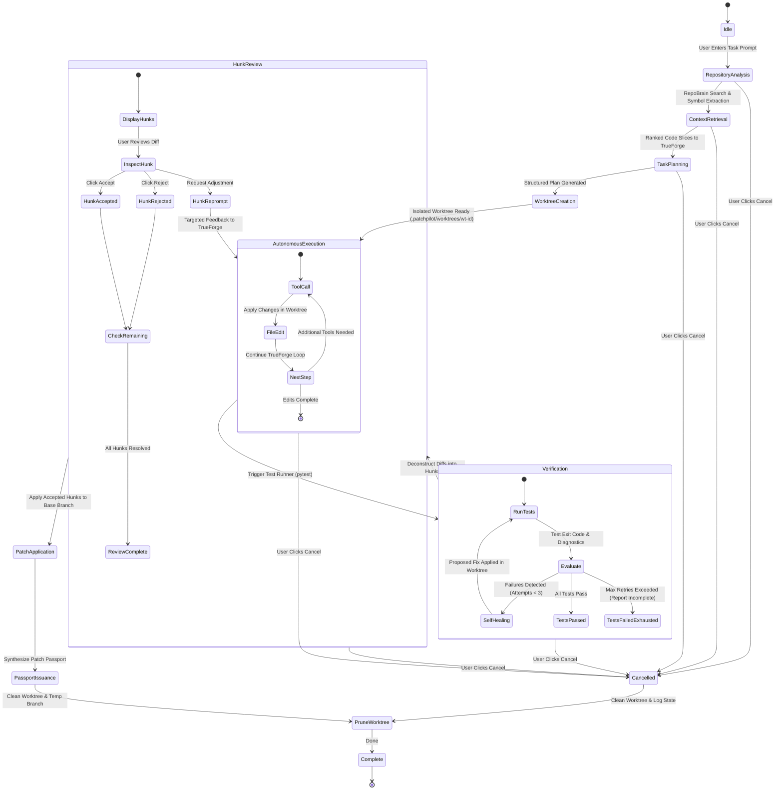
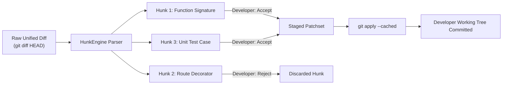
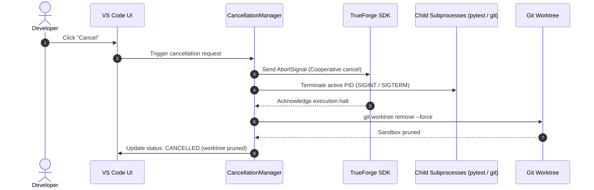
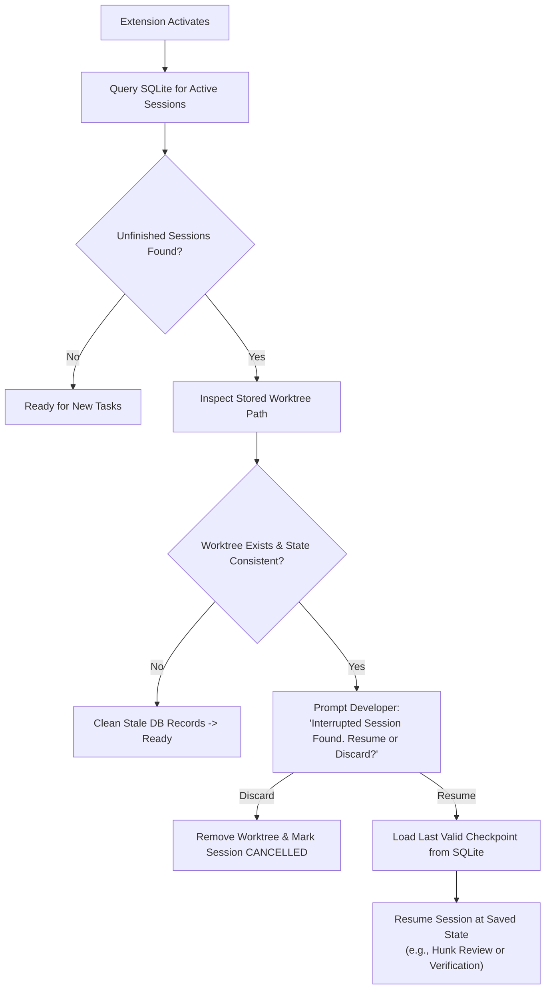

# PatchPilot — Workflow & Lifecycle Architecture

**Product:** PatchPilot  
**Status:** Proposed Architecture & Technical Design (Milestone 0 Foundation)  
**Agent Harness:** TrueForge (`@truefoundry/trueforge-sdk`)  
**Documentation Authority:** Subordinate to [docs/PRD.md](file:///e:/MADHURA/PROJECTS%20madhura/PatchPilot/docs/PRD.md)

---

## 1. End-to-End Execution Lifecycle

The lifecycle of a PatchPilot session moves through explicit stages to guarantee safety, verification, and developer control:



---

## 2. Detailed Phase Specifications

### Phase 1: User Request & Intent Parsing
1. Developer enters a natural language prompt via the PatchPilot VS Code Sidebar.
2. The `SessionManager` initializes a new session record in SQLite (`.patchpilot/session.db`) with status `INITIALIZED`.
3. An active `AbortController` is attached to the session context.

### Phase 2: Repository Analysis & Context Retrieval (RepoBrain)
1. TrueForge requests context related to the user prompt.
2. RepoBrain coordinates discovery:
   - **Lexical Discovery (P0):** Invokes `ripgrep` across the repository to locate direct keyword hits, class definitions, and function invocations.
   - **AST Symbol Extraction (P1):** Invokes Tree-sitter on candidate files to extract symbol relationships (e.g., class signatures, decorators, imports).
3. Candidate snippets are ranked. High-relevance code slices are packaged into token-bounded context blocks and streamed to TrueForge.

### Phase 3: Task Planning
1. TrueForge analyzes the context and formulates a structured JSON execution plan.
2. The plan identifies:
   - Specific target files to modify.
   - Associated test suites to run.
   - Anticipated side effects.
3. The plan is displayed in the VS Code sidebar for developer review.

### Phase 4: Isolated Workspace Provisioning
1. `WorktreeManager` executes:
   ```bash
   git worktree add -b patchpilot/session-<id> .patchpilot/worktrees/wt-<id> HEAD
   ```
2. The isolated environment is verified. The developer's active workspace and uncommitted files remain untouched.

### Phase 5: Autonomous Multi-File Execution (TrueForge Loop)
1. TrueForge executes its model-driven loop, reading files from and writing modifications to the worktree directory.
2. Tool calls are executed through the Layer 4 tool harness.
3. Every step updates the session state in SQLite.

### Phase 6: Bounded Self-Healing Verification Loop
1. Once file edits are complete, PatchPilot executes the verification suite inside the worktree (e.g., `pytest tests/`).
2. **If all tests pass:** Test outputs, execution time, and status are stored in the verification evidence record.
3. **If tests fail:**
   - Stack traces, error logs, and failure details are captured.
   - A diagnostic message is fed back to the TrueForge agent loop:
     > *"Verification failed with exit code 1. Diagnostics: AssertionError at line 42. Please inspect the failure and provide self-correcting edits."*
   - TrueForge attempts a bounded repair cycle (maximum 3 retry iterations).
   - If tests fail after 3 iterations, execution halts and the failure diagnostics are presented directly to the developer. Unexecuted or failed tests are never reported as passed.

### Phase 7: Hunk Intelligence & Human-in-the-Loop Review
1. PatchPilot runs `git diff HEAD` inside the worktree to generate the unified diff across all modified files.
2. The `HunkEngine` parses the unified diff into discrete, semantically contextualized hunks.
3. The custom **Hunk Review Webview** opens in VS Code, displaying:
   - Impacted file path and surrounding code context.
   - Unified side-by-side or inline diff with syntax highlighting.
   - Action buttons:
     - **Accept:** Mark hunk for inclusion.
     - **Reject:** Discard hunk; retain original code.
     - **Re-Prompt:** Enter natural language feedback to request TrueForge regenerate or adjust that specific hunk.



### Phase 8: Patch Application & Workspace Cleanup
1. The accepted hunks are assembled into a synthesized patch and applied to the user's active branch:
   ```bash
   git apply --cached < synthesized_patch.patch
   git checkout -- . # sync working directory with index
   ```
2. The temporary worktree and branch are removed:
   ```bash
   git worktree remove --force .patchpilot/worktrees/wt-<id>
   git branch -D patchpilot/session-<id>
   ```

### Phase 9: Patch Passport Issuance
1. The `PatchPassportGenerator` compiles the final manifest containing:
   - Original user intent.
   - Model ID and TrueForge session telemetry.
   - Files and symbols modified.
   - Hunk review breakdown (accepted vs rejected).
   - Test execution evidence and logs.
   - Manifest schema version and metadata.
2. The manifest is stored in `.patchpilot/passports/<passport_id>.json` and rendered in the Patch Passport viewer.

---

## 3. Cancellation Architecture

Immediate, safe cancellation is a core requirement of the TrueFoundry Forge-a-thon.



1. **Cancellation Requested vs Confirmed:** Clicking Cancel transitions the UI to `Cancelling`. Execution is considered cancelled only once TrueForge confirms the halt and subprocesses exit.
2. **Process Termination:** Active child processes receive `SIGINT`/`SIGTERM`, followed by `SIGKILL` if unresponsive after a short grace period.
3. **Worktree Teardown:** The temporary worktree and branch are pruned with `git worktree remove --force`.
4. **Developer Workspace Preservation:** Because edits were confined to the worktree, the developer's working directory remains protected from incomplete edits.

---

## 4. Crash Recovery & Resumption Architecture

Network drops, model rate limits, or IDE restarts must not corrupt repository states or lose completed reasoning.



1. **Monotonic Checkpoints:** Checkpoints are stored in SQLite at every stage transition:
   - `CHECKPOINT_PLAN_READY`
   - `CHECKPOINT_EDITS_APPLIED`
   - `CHECKPOINT_TESTS_COMPLETED`
   - `CHECKPOINT_REVIEW_IN_PROGRESS`
2. **Conditional Resumption:** If VS Code restarts, PatchPilot checks the integrity of the worktree and checkpoint payload. If state is clean, the developer is offered a resume path. If state is corrupted or uncertain, PatchPilot requires reconciliation or safe discard.
3. **Idempotence Objective:** Re-running from a checkpoint is designed to avoid duplicate file edits or duplicate worktree allocations.
